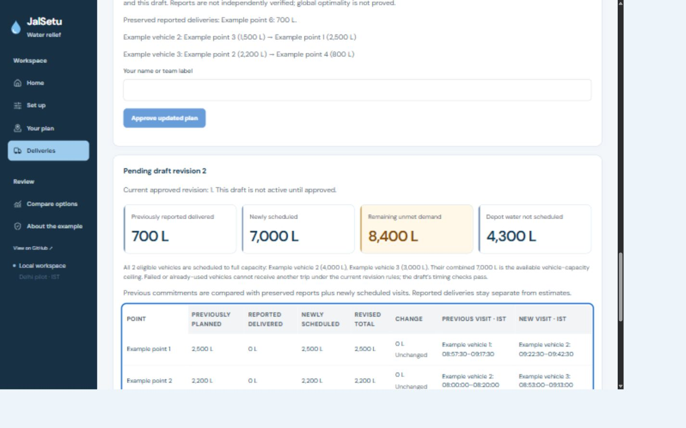

# JalSetu

Water-relief planning, delivery reporting and recovery after disruptions.

**[Live demo](https://main.d2d0jtitb5ozce.amplifyapp.com/)** · **[Architecture](docs/architecture.md)** · **[Data and limitations](docs/limitations.md)**

JalSetu helps coordinators allocate limited water across confirmed requests, compare delivery plans, approve vehicle instructions and replan when deliveries change. The hosted demo uses labelled synthetic exercises. It is a planning prototype, not a field-tested relief service.



*Screenshot from the locally verified UI revision; the live website may run an earlier release. GitHub changes do not automatically deploy the website.*

## Features

- **Set up:** depot water, available vehicles, receiving-point requests, priorities and operating windows.
- **Compare:** JalSetu, equal-share, demand-proportional and priority-first greedy plans under the same rules.
- **Approve:** review allocations and stop sequences before activating vehicle instructions.
- **Report:** loading, cumulative deliveries, breakdowns, physical water recovery, returns, stock changes and receiving-point closure/reopening.
- **Adapt:** calculate revised allocations for eligible unused vehicles at the depot, preserving previous reports. Draft review and approval remain separate.
- **Resume:** reopen saved runs with report history, the water ledger, approved revision and pending revised draft. The latest source supports account-scoped refresh restoration through the authorized API.
- **Navigate and export:** numbered map stops, external Google Maps directions, delivery CSVs and printable vehicle instructions.

## Try the example

1. Open the live demo. Create an email/password account, verify your email and sign in. Google authentication is not used.
2. Start the guided example. Review **Water & timing**, **Vehicles** and **Water requests**. Choose loading and closing rules explicitly.
3. Generate delivery options, compare alternatives, then review and approve your chosen plan.
4. Open **Deliveries**. Record loading and cumulative delivery totals. Repeating the same delivered total adds no water.
5. Record a breakdown and any water physically recovered at the depot. Calculate a revised draft, review its allocation changes and approve it deliberately.

Approval does not dispatch vehicles or report deliveries. Reported quantities are coordinator-entered, not independently verified. Water remaining on a failed vehicle stays stranded until an explicit recovery report.

## Reproducible sample results

The documented North Delhi fixture uses **finish-by-close**, **parallel loading**, 100-litre planning increments and seed 42.

| Modelled result | Value |
| --- | ---: |
| Water planned | 12,000 L |
| Unmet requested water | 4,100 L |
| Points receiving their stated minimum | 8 of 8 |
| More planned than demand proportional | 900 L |
| Additional estimated travel versus demand proportional | 0.9 km |

These are checked sample calculations, not measured deliveries or real-world impact. JalSetu does not outperform every alternative on every metric, and global optimality is not claimed. `pnpm test:polish` reproduces the displayed results with the current planner and verifies the fixture hash and rules. See [evaluation](docs/evaluation.md).

## AWS architecture

| Service | Role |
| --- | --- |
| AWS Amplify Hosting | React frontend hosting |
| Amazon Cognito | Email/password access and OAuth authorization code with PKCE |
| Amazon API Gateway | Authorized backend endpoints |
| AWS Lambda | Backend handlers and bounded planning workers |
| AWS Step Functions Standard | Planning stages, retries and completion/failure handling |
| Amazon DynamoDB | Account-scoped projects, jobs, operations and reports |
| Amazon S3 | Private snapshots and immutable planning results |
| Amazon CloudWatch | Application logs with bounded retention |
| Amazon EventBridge | Terminal workflow failure handling |

The Python planner uses Pydantic and OR-Tools, followed by independent validation. The local Node adapter supports development without AWS. The hosted exercise uses stored travel estimates and deterministic explanations; it does not call Amazon Location or Amazon Bedrock.

Cognito subject identifiers scope user ownership. Browser storage is a navigation aid, never an authorization mechanism. Backend authorization, conditional versions and idempotency safeguards protect saved operations.

## Run locally

Requirements: **Node 24**, **pnpm 11.22.0** and **Python 3.12**.

```powershell
py -3.12 -m venv .venv
.\.venv\Scripts\python.exe -m pip install -r services/planner/requirements.txt
pnpm install --frozen-lockfile
pnpm start
```

Open **http://127.0.0.1:8787/local-workspace**. On Windows, **Start JalSetu.cmd** builds and starts the same loopback application. Keep its terminal open; press Ctrl+C to stop it.

For development, `pnpm dev` serves **http://127.0.0.1:5173/local-workspace**, with the local API on port 8787. Both paths use the normal local saved-data directory. Avoid running two servers on the same port.

On Linux/macOS, create `.venv` with `python3 -m venv .venv`, then install requirements with `.venv/bin/python`. Alternatively set `JALSETU_PYTHON` to a compatible interpreter. Local development is explicitly labelled as unauthenticated and does not unlock protected hosted routes.

## Verification

```powershell
pnpm check:local
pnpm check:hosting
pnpm test:polish
```

The latest implementation gate passed lint, TypeScript checks, **240 Python tests**, frontend/authentication regressions and **six local release/restart acceptance groups**. The hosting gate checks production files and synthesizes infrastructure locally; it does not deploy AWS resources. Three existing SWIG deprecation warnings and a frontend bundle-size advisory remain.

Checks cover water conservation, cumulative delivery totals, durable pending drafts, restoration errors/retries, subject isolation, report guidance, event ordering, map failure/retry states and reproducible sample results. Browser checks use isolated synthetic records. See [UI/workflow verification](docs/ui-polish-2026-10-11.md) and its [audit](docs/audit/ui-polish-2026-10-11.json).

## Data and limitations

- The hosted release is **example-only**. Local projects additionally support operator-entered records, CSV previews and historical comparisons: [records guide](docs/using-operational-records.md), [original-plan comparison](docs/comparing-original-delivery-plans.md).
- [Public-road research](docs/public-road-checkpoint-2026-10-10.md) uses sourced OSRM/OpenStreetMap estimates alongside example relief inputs. It does not prove field benefit or provide live traffic tracking.
- Dashed map connections show **stop order**, not navigable road geometry. External directions require coordinator/driver review.
- Current revisions use unused depot vehicles. Active-vehicle/fixed-stop replanning and second visits to positively reported points are outside this prototype.
- A capacity ceiling is explained only when actual draft and ledger evidence establish it. Other cases explicitly state that a verified limiting-constraint explanation is unavailable.
- Automatic active-run restoration requires browser storage. Local in-flight jobs are ephemeral across server restarts; completed operations and drafts remain saved.
- Genuine operational records, independent coordinator feedback, real-inbox signup/reset acceptance and a comprehensive accessibility audit remain separate validation work.

## Hosting and updates

The existing Mumbai demo has an original planning expiry of **17 October 2026, 22:57:30 IST**. Application expiry does not delete infrastructure; reviewed cleanup is still necessary.

The project spending boundary is **$100 in credits, with no out-of-pocket spending**. Current account balances are not published here. Preserve the existing free plan; estimates and budget alerts are not monetary caps.

GitHub pushes do **not** automatically deploy this manually published Amplify branch. The latest UI polish is source-verified, not claimed as deployed. A reviewed frontend publication uses `scripts/publish-hosted-web.ps1`, which checks the free-plan/credit safeguard, existing hosting identity, production bundle and unchanged expiry. Infrastructure and Cognito changes require a separate review. Never commit passwords, temporary sessions or AWS access keys.

[Hosted release history](docs/aws-hosted-release-2026-10-11.md) · [Email-only access](docs/aws-email-ui-release-2026-10-11.md) · [Callback correction](docs/signin-callback-fix-2026-10-11.md) · [Build status](docs/build-status.md)

## Source and notices

The repository is public. A project license has not yet been selected; public visibility alone does not grant a reuse license. Dependency notices and AI-tool disclosure are in [NOTICE.md](NOTICE.md). Historical phase documents are retained as development evidence; current checkpoints supersede their older status statements.
