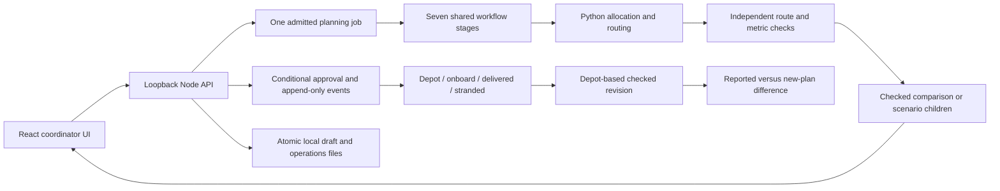
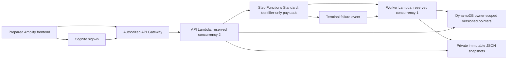

# JalSetu architecture

Solid local flow is exercised today. The separate AWS graph is prepared and tested offline; it is not evidence of deployed resources.

The seven stages validate saved inputs, read the stored example matrix, solve, independently check, persist, render deterministic explanation and complete. Stage receipts prevent repeated solves after a lost response. Scenario batches use the same admission and stage machinery; six separately solved child records have stable IDs and input snapshots. They cannot be approved as dispatch plans through the approval endpoint.

Only an explicit cumulative report consumes delivered water. Failure strands loaded remainder; recovery requires its own event. Revisions preserve reports and plan only with unused vehicles at the depot. The UI keeps actual reports separate from new estimates. Receiving-point closure/reopening events derive a persistent closed-point set without touching stock. Closed points are excluded from pending revision inputs and independently checked routes, while original requests and earlier reports remain in shortfall accounting. Legacy ledgers keep their original shape until a site-status event is recorded.

Live routing/weather and optional Bedrock access are pending. Their offline contracts do not contact a provider. Cloud deployment additionally requires verified account access, the quota decision, credit/eligibility review and live acceptance. See [AWS foundation](aws-foundation.md) and [limitations](limitations.md).
