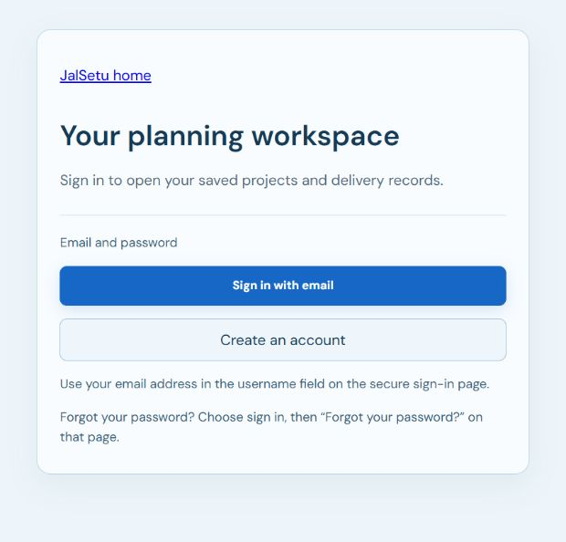

# Email-only UI release — 11 October 2026

The updated blue frontend is published at [JalSetu](https://main.d2d0jtitb5ozce.amplifyapp.com/). The owner removed Google authentication from the product scope. The workspace now offers **Sign in with email** and **Create an account** only. There is no disabled Google button or Google setup notice. Google Maps route links remain part of the existing driver workflow.

## Deployed changes

- CloudFormation `JalSetuDemo` reached `UPDATE_COMPLETE`; Amplify main-branch release **2** reached `SUCCEED`.
- Fresh public configuration has `authProvider: "Email"`, the registered `/auth/callback`, and the original expiry. The live index references `index-CW6_UuPK.js`, matching the locally validated build.
- The existing Cognito pool allows self-registration, automatically verifies email and uses verified email for password recovery. Passwords require 12 characters, upper/lowercase letters, a number and a symbol. The existing Cognito email sender is used; no SES service was added.
- The public client supports **COGNITO only**; the live pool has **zero external identity providers**. Infrastructure defaults to Email and refuses other provider modes. Google client IDs, Google secrets and the unused Google deployment-policy example are no longer required.
- Sign-in uses Cognito's managed email/password page and authorization code with PKCE S256, state and nonce. The API and browser verify the intended client and verified native identity. API Gateway's audience restriction is set on its underlying CloudFormation authorizer; a new API deployment applies it to the stage.
- The pool, public client, DynamoDB table, snapshot bucket and website identity were preserved. User ownership still uses Cognito subject IDs; records were not migrated or merged.
- The public landing page, animations, qualitative preview, account-scoped onboarding, workspace protections and existing operations remain in place. Expired-session and landing copy now describe email access.

## Verification

Lint, production build, CDK assertions, public hosting-bundle checks and frontend authentication/DOM checks passed. **240 Python tests passed** with three existing SWIG deprecation warnings. The actual Linux image passed offline planning, seven-stage orchestration, immutable results, scenario limits and Lambda runtime checks.

Live browser checks confirmed the landing page, email-only gate, signup form, managed sign-in page and password-recovery page. The signup form has email/password fields only. Mobile checks found no horizontal overflow, 48px inputs and controls at least 44px high. Anonymous `/v1/example` returned HTTP 401. The deployed CSP allows Cognito signup and signing-key requests.

AWS readback confirmed the account settings, COGNITO-only client, absence of external identity providers, successful releases and unchanged resource identities. See the [sanitized deployment audit](audit/aws-email-ui-release-2026-10-11.json).

**Subsequent acceptance:** Release 3 corrects Amplify’s trailing-slash callback handling. Real email/password sign-in and authenticated page reload were verified with the owner entering credentials privately. See [the defect, correction and actual acceptance](signin-callback-fix-2026-10-11.md).

**Still to check with a real inbox:** signup-code delivery/confirmation and password recovery. The existing hosted operations evidence does not independently prove a full workflow under a newly self-registered account. Signed synthetic-token tests are software checks, not real email delivery evidence.

## How to use it

1. Open the live site and choose **Sign in**.
2. Choose **Create an account**, enter your email and a private password, then submit.
3. Enter the verification code from your email. Confirmation opens secure sign-in.
4. Enter the same email in Cognito's **Username** field and your password. The existing pool retains its username schema to preserve accounts; signup uses your email as that username. Preserve the same spelling/case.
5. Open the guided example. To recover access, choose **Sign in with email → Forgot your password?**

Cognito's own Sign up link also remains on its managed sign-in page and may request a username separately. Previously invited accounts retain their existing usernames. No phone signup or Google authentication is configured.

## Cost, expiry and future updates

The fresh AWS plan and credit checks were completed privately; the account balance is withheld from public evidence. The project ceiling stays **$100 credits-only**, with no account-plan upgrade. This update made AWS deployment, image publication and hosting calls; it does not claim zero usage or a real-time final bill. Application concurrency limits remain 1 planner / 2 API, with 100 planning jobs per day. Routing and AI service calls remain excluded.

Planning access expires at **2026-10-17T17:27:30Z (17 October, 22:57:30 IST)**. This is an application expiry, not automatic infrastructure deletion; reviewed cleanup is still necessary.

Code remains editable after publication. Build/check frontend changes and use `scripts/publish-hosted-web.ps1` to publish a new reviewed bundle. Infrastructure changes require synthesis, diff review and deployment through the restricted role. GitHub pushes alone do not deploy this manually published Amplify branch. Temporary AWS credentials stay outside the repository.

Earlier Google-only/dual-provider completion documents describe superseded implementation history; their Google activation steps no longer apply.
