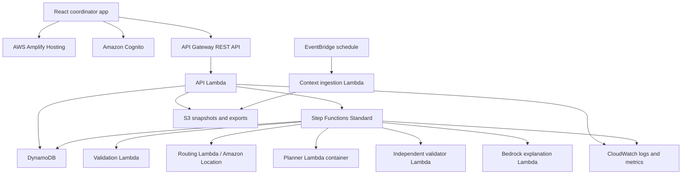
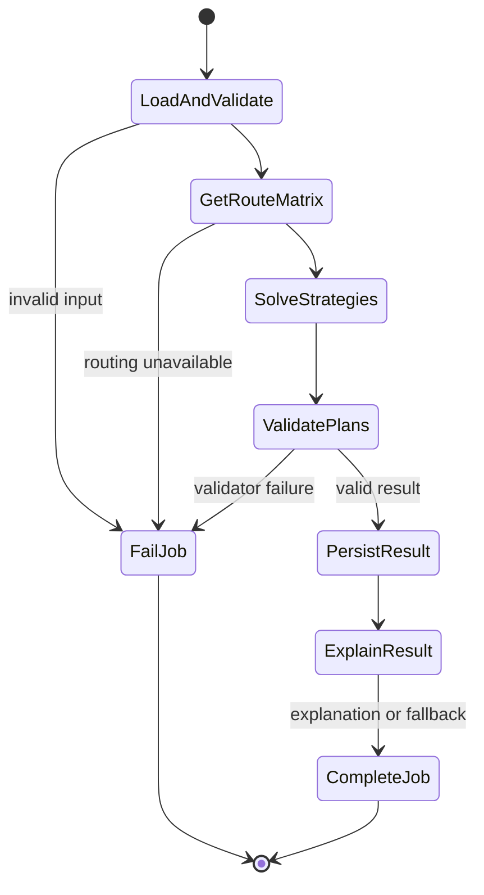

# JalSetu - Complete AI Build Specification

> **Working product name:** JalSetu - Heat Relief Dispatch  
> **Document type:** implementation contract for an AI coding agent  
> **Prepared:** 8 October 2026, India Standard Time  
> **Target event:** WeMakeDevs × AWS Environmental Hacks, Heat and Water track  
> **Primary goal:** produce the strongest honest, working, demonstrable submission possible within the hackathon window  
> **Status:** build plan only; this document does not claim that the application, integrations, benchmarks, user validation, or AWS deployment already exist

---

## 1. Instructions to the coding AI

You are implementing the project defined in this document. Treat this file as the product and engineering contract.

Follow these rules throughout the build:

1. Build the phases in order. Do not begin optional work until the current phase meets its acceptance gate.
2. Keep the application runnable after every phase.
3. Do not invent data, partnerships, user interviews, test results, performance numbers, AWS costs, or deployment status.
4. Values marked **EXAMPLE** are synthetic demonstration inputs. Display them as example or simulated data everywhere they appear.
5. Values marked **TEAM DECISION** must remain configurable until the team supplies an answer. Use the documented default only for local development.
6. Never infer actual water shortage, dehydration, medical risk, site availability, vehicle availability, or delivery completion from weather, population, or map data.
7. The deterministic planner owns allocation, routing, constraints, accounting, metrics, and replanning. A language model may explain validated results or propose structured changes for human review. It must never change the plan directly.
8. Every number shown in a plan must be traceable to an input, a deterministic calculation, or a clearly labelled modelled estimate.
9. Every external dataset must carry its retrieval time, represented date/year, attribution, licence/source link, geographic coverage, and limitations.
10. Prefer one complete, reliable workflow over extra screens or services.
11. Do not claim mathematical optimality unless the solver returns a proven optimal status. Otherwise use wording such as `best feasible plan found within the time limit`.
12. Do not claim people were served merely because water was allocated or a delivery was recorded.
13. Do not commit secrets, AWS account identifiers, private URLs, callback tokens, access keys, passwords, or personal information.
14. Do not use old project code created before the hackathon opening. Open-source libraries, public APIs, boilerplate, and generated code must be credited and licensed appropriately.
15. Record all AI coding tools used so they can be disclosed in the submission writeup.

When a requirement is ambiguous, choose the smallest behavior consistent with the product goal and record the decision in `docs/decisions.md`. Do not silently expand the scope.

---

## 2. Product definition

### 2.1 One-sentence product

JalSetu helps a relief coordinator turn confirmed water requests, available stock, vehicles, site time windows, and current road estimates into a feasible delivery plan for a critical heat-response window, compare it with simple strategies, and repair it when a vehicle or site becomes unavailable.

### 2.2 The specific user

The primary user is one coordinator responsible for a small supplemental water-relief operation. Examples include an NGO coordinator, campus emergency coordinator, shelter network coordinator, or community volunteer lead.

The prototype is not presented as an official Delhi Jal Board dispatch system and does not claim integration with a government department.

### 2.3 The decision JalSetu changes

The coordinator needs to decide:

- which confirmed sites receive water;
- how many litres each site receives;
- which vehicle serves each site;
- in what order the vehicle visits sites;
- whether the delivery can occur within each site's accepted window;
- which requests remain unmet;
- how the plan changes after a disruption; and
- which additional resource would reduce the remaining shortfall most.

### 2.4 Intended first release

The first release supports:

- one project/pilot area in Delhi;
- one depot or water source;
- one homogeneous commodity measured in litres of potable water;
- 1 to 5 vehicles;
- 1 to 20 confirmed candidate distribution sites;
- one planned operating day;
- one trip per vehicle for the judged workflow;
- site-specific requested volume, minimum useful delivery, storage limit, service window, service duration, and operator-declared priority;
- allocation and route planning;
- three baseline strategies;
- one approved plan revision at a time;
- vehicle-loss, site-closure, stock-change, travel-delay, and request-change disruptions;
- independently validated results;
- task-card and evidence-summary exports; and
- optional grounded explanation through Amazon Bedrock.

The supported limits above are product limits for the prototype. They are not statements about city-scale capacity.

### 2.5 Explicit non-goals

Do not build these into the judged workflow:

- citywide Delhi tanker control;
- live GPS tracking of real vehicles;
- automatic dispatch to government tankers;
- water-quality certification;
- payment processing;
- citizen identity or beneficiary registration;
- medical diagnosis or clinical heat-risk scoring;
- street-level temperature prediction;
- leak detection;
- flood-depth or road-passability prediction;
- stock, fleet, or site facts inferred from public data;
- unverified venues automatically becoming relief sites;
- multi-depot planning;
- tanker refilling or multiple trips per vehicle;
- continuous route navigation;
- automatic WhatsApp/SMS sending;
- native mobile applications;
- arbitrary city or nationwide scaling claims;
- blockchain; or
- autonomous AI agents that can execute dispatch decisions.

These may appear in a future-work section only.

---

## 3. Why this version can stand out

Water allocation and vehicle routing are established ideas. JalSetu's competitive strength must come from execution and evidence:

1. It produces an operational plan rather than only a heat map.
2. It separates public context from operator-confirmed operational facts.
3. It proves that allocations are deliverable under capacity, time, stock, and site constraints.
4. It compares its result against reasonable baselines using identical inputs.
5. It exposes unmet needs instead of hiding them.
6. It repairs a plan after disruption without double-counting completed deliveries or recreating lost stock.
7. It calculates which marginal resource helps most.
8. It uses AI only to explain validated results or translate a proposed change into reviewable structured fields.
9. It provides a source and assumptions ledger that a judge can inspect.
10. It can be demonstrated end to end in under three minutes.

The winning argument is: **JalSetu makes a constrained relief decision more transparent, feasible, and resilient, and demonstrates the improvement with reproducible scenarios.**

---

## 4. Truth model: facts, estimates, assumptions, and outcomes

Every field and screen must distinguish these categories.

| Category | Meaning | Examples | UI treatment |
|---|---|---|---|
| Public source fact | Retrieved from a named external source | forecast value, dataset year, route matrix result | Source name, represented time, retrieval time, link and age badge |
| Operator-confirmed input | Entered or confirmed by the coordinator | stock, vehicle capacity, site request, opening window | `Coordinator input` badge and last-edited time |
| Example input | Synthetic data supplied for demonstration | demo fleet and site requests | Persistent `EXAMPLE DATA` banner and row badges |
| Computed result | Deterministically calculated and validated | allocated litres, arrival time, route distance | `Computed` label and plan version |
| Modelled context | Estimate with a defined model | WorldPop population estimate | `Modelled estimate` label, dataset year and limitations |
| User-reported outcome | A person recorded an event | delivery completed, site closed | `Reported` label, reporter and timestamp |
| Independently verified outcome | Confirmed through a separate evidence process | outside first-release scope | Never display unless verification exists |

The UI must never replace these labels with vague terms such as `real-time`, `AI verified`, `ground truth`, or `people helped`.

---

## 5. User stories and required behaviors

### 5.1 Coordinator creates a planning project

As a coordinator, I can create a project for one operating day, choose a small supported Delhi pilot area, name a depot, and declare whether the data are real operator inputs or a synthetic scenario.

Acceptance behavior:

- The project requires a timezone of `Asia/Kolkata`.
- All stored timestamps use UTC ISO 8601; all user-facing operational times display in IST.
- The selected date, pilot polygon, depot coordinate, and data mode are visible on the project overview.
- Unsupported or oversized polygons are rejected with a readable reason.

### 5.2 Coordinator enters operational resources

The coordinator can enter:

- total available water stock in litres;
- depot opening and closing times;
- loading duration per vehicle;
- vehicle name;
- vehicle capacity in litres;
- vehicle availability window; and
- optional notes.

Acceptance behavior:

- Quantities are integers and non-negative.
- Vehicle capacity must be greater than zero.
- Total planned loading cannot exceed declared stock.
- Every example value remains labelled.
- Missing vehicles do not cause the system to invent a fleet. The project may save as a draft, but no route can be declared feasible.

### 5.3 Coordinator enters confirmed sites

Each site contains:

- name;
- latitude and longitude;
- confirmation state: `draft`, `contacted`, or `confirmed`;
- requested volume in litres;
- minimum useful delivery in litres;
- storage/receiving limit in litres;
- opening and closing times;
- service duration in minutes;
- priority class selected by the operator: `critical`, `high`, or `standard`;
- priority reason as free text;
- accessibility notes; and
- contact label only, without unnecessary personal data.

Acceptance behavior:

- Only `confirmed` sites may enter an approvable plan.
- The minimum useful delivery cannot exceed the request.
- The requested volume cannot exceed the receiving limit unless the UI explicitly asks the coordinator to correct one of the fields.
- Coordinates must be inside the supported project area.
- A mapped place or public amenity is only a candidate until the coordinator confirms it.

### 5.4 Coordinator reviews public context

The project may show:

- hourly weather context from Open-Meteo;
- historical scenario weather from the Open-Meteo archive;
- WorldPop population estimates for context; and
- map and route information through Amazon Location Service.

Acceptance behavior:

- Source metadata and limitations appear next to every external value.
- Weather does not create a site request or priority automatically.
- Population does not become demand automatically.
- Failure to refresh a source leaves the previous snapshot visible with its real age and a warning.
- Planning remains possible with approved cached routing/context snapshots.

### 5.5 Coordinator generates a plan

The system creates an asynchronous planning job and shows `queued`, `validating`, `routing`, `solving`, `checking`, `explaining`, `completed`, or `failed` status.

The result includes:

- allocated and scheduled litres per site;
- vehicle routes and ordered stops;
- estimated arrival and departure times;
- travel time and distance;
- unmet volume per site;
- total on-time delivered volume;
- minimum site fulfilment among served sites;
- plan assumptions and source snapshot identifiers;
- solver status and time limit;
- validation outcome; and
- a plain-language summary generated deterministically even if Bedrock is unavailable.

### 5.6 Coordinator compares strategies

The same inputs are evaluated under:

1. **Equal-share baseline:** divide feasible stock/capacity evenly among confirmed sites, respecting minimum useful deliveries, then route.
2. **Demand-proportional baseline:** divide feasible stock/capacity proportional to declared requests, then route.
3. **Greedy baseline:** repeatedly select the highest operator priority, then earliest closing time, then shortest incremental travel time; assign as much as feasible.
4. **JalSetu strategy:** allocation and routing procedure specified in Section 11.

All strategies must use the same:

- stock;
- vehicles;
- site requests;
- time windows;
- travel matrix;
- service durations;
- planning deadline; and
- independent validator.

No baseline may be made deliberately infeasible or simplistic to create a favourable comparison.

### 5.7 Coordinator reviews and approves

The coordinator can approve a completed, valid plan revision.

Acceptance behavior:

- A plan with validation errors cannot be approved.
- Approval stores the plan version, actor, UTC timestamp, input snapshot hash, and validation report hash.
- Approval means the user accepted the software plan. It does not mean a real dispatch occurred.
- Editing resources or sites after approval creates a new draft version; it never changes the approved revision in place.

### 5.8 Coordinator records delivery state

For each planned stop the coordinator can report:

- `not_started`;
- `en_route`;
- `arrived`;
- `completed`;
- `partial`; or
- `failed`.

For partial/completed outcomes, the coordinator enters litres actually delivered and a timestamp.

Acceptance behavior:

- Completed litres cannot exceed the planned stop quantity without an explicit corrected plan.
- Idempotent updates prevent repeated clicks from consuming stock twice.
- Every state transition is recorded as an immutable event.
- Reported completion is labelled as a user report.

### 5.9 Coordinator replans after disruption

Supported disruptions:

- vehicle becomes unavailable;
- site closes;
- stock is reduced or increased;
- travel-time multiplier changes;
- request or receiving limit changes; and
- vehicle start time is delayed.

Acceptance behavior:

- Completed deliveries remain fixed.
- Delivered stock remains consumed.
- Stock already loaded on a failed vehicle is unavailable by default.
- The coordinator may explicitly record recovered litres and recovery time; only then may that stock return.
- Stops already in progress are either fixed or deliberately cancelled by the coordinator.
- The revised plan has a new version and explains changes from the approved plan.

### 5.10 Coordinator runs a marginal-resource analysis

With one action, the system independently evaluates these configurable alternatives against the current unmet demand:

- add **EXAMPLE** 1,000 litres of stock;
- add one **EXAMPLE** vehicle with a configurable capacity;
- start all available vehicles **EXAMPLE** 30 minutes earlier where depot/site windows allow;
- extend one bottleneck site's closing time by **EXAMPLE** 30 minutes; and
- reduce service duration by **EXAMPLE** 5 minutes, clearly labelled as a scenario rather than an operational recommendation.

The UI reports the change in on-time litres, unmet litres, served sites, and travel. Each alternative must be re-solved; a language model may not estimate the effect.

### 5.11 Coordinator exports the plan

Required exports:

- coordinator plan summary as printable HTML/PDF or browser print view;
- one task card per vehicle as printable HTML/PDF;
- CSV of stop assignments;
- JSON of the complete plan and validation report; and
- source/assumption ledger.

Every export includes project name, revision, data mode, creation time, approval state, source ages, and unresolved limitations.

---

## 6. Success criteria

### 6.1 Product success

The product succeeds when a first-time coordinator can:

1. load the example scenario;
2. understand which inputs are synthetic;
3. generate a feasible plan;
4. see how it compares with baselines;
5. approve the plan;
6. mark one stop completed;
7. remove a vehicle or close a site;
8. generate a valid revision that preserves completed work;
9. identify the most useful marginal resource; and
10. export readable task cards.

### 6.2 Required measured metrics

Record these for every strategy and scenario:

- on-time delivered litres;
- total unmet requested litres;
- number of confirmed sites with any on-time delivery;
- number of sites meeting their minimum useful delivery;
- minimum, median, and mean fulfilment ratio across sites with positive requests;
- critical-site minimum litres delivered;
- total travel distance;
- total travel time;
- latest route completion time;
- solver wall-clock runtime;
- job end-to-end runtime;
- solve status;
- dropped/unserved site count; and
- validation error count.

### 6.3 Impact wording

Allowed when supported by recorded results:

- `delivered X more modelled litres within declared windows than baseline Y in scenario Z`;
- `reduced unmet requested volume by X% in scenario Z`;
- `produced a constraint-valid revision after the simulated disruption`; and
- `a test participant completed the planning task in X minutes under the recorded conditions`.

Disallowed without independent evidence:

- `saved lives`;
- `prevented dehydration`;
- `served X people`;
- `eliminated corruption`;
- `works citywide`;
- `real-time Delhi data`;
- `optimal route` when optimality was not proved; or
- `zero emissions` or `reduced emissions` without a defined, equivalent-service calculation.

---

## 7. Technical architecture

### 7.1 Architecture principles

- AWS services must produce visible product behavior or necessary operational qualities.
- The browser never holds AWS credentials with broad permissions.
- Planning is asynchronous; the HTTP request returns quickly with a job identifier.
- Every plan uses immutable input and source snapshot identifiers.
- The planner is deterministic for the same input snapshot, configuration, travel matrix, and solver seed.
- AI failure never prevents access to a validated plan.
- Local development must work without paid cloud calls by using stored fixtures and mocks.
- The deployed demo must exercise the real AWS path shown in the video.

### 7.2 Target architecture



### 7.3 AWS service responsibilities

| Service | Required role | Evidence to show judges |
|---|---|---|
| AWS Amplify Hosting | Deploy the React SPA through a Git-connected build | Public app URL and deployment view |
| Amazon Cognito | Coordinator authentication and API authorization | Signed-in coordinator, protected API call |
| Amazon API Gateway REST API | Stable HTTPS API, Cognito authorizer, validation, throttling | Network request/job creation in demo |
| AWS Lambda | API handlers, validation, source ingestion, routing adapter, validator, exports and explanation adapter | CloudWatch logs with shared correlation ID |
| Amazon ECR | Store the planner container image with OR-Tools dependencies | Image tag linked to commit SHA |
| AWS Step Functions Standard | Orchestrate validate → route matrix → solve → validate → explain → persist | Execution graph for the demonstrated job |
| Amazon DynamoDB | Projects, jobs, immutable plan revisions, status events and idempotency | Persisted version history |
| Amazon S3 | Versioned source snapshots, generated exports and evidence manifests | Object metadata/source manifest |
| Amazon Location Service | AWS-hosted map styles and route matrices | Route matrix request and map/route result |
| Amazon Bedrock | Optional explanation of already validated structured results | Explanation plus deterministic fallback test |
| Amazon EventBridge Scheduler | Refresh public context outside interactive requests | Scheduled ingestion execution |
| Amazon CloudWatch | Structured logs, metrics, dashboards and alarms | Planning-success metric and error alarm |
| AWS CDK | Repeatable infrastructure and least-privilege roles | `cdk synth`, stack diagram/README |
| AWS Budgets | Spending alerts | Budget configuration screenshot, with delayed-alert limitation disclosed |
| AWS WAF | Optional after the complete flow works; basic managed rules and rate rule on REST API | Only include if deployed and tested |

Do not add SQS, ECS/Fargate, RDS, OpenSearch, SageMaker, IoT Core, SNS, or additional services unless a measured requirement needs them. A large service count is not the product goal.

### 7.4 Region selection

**TEAM DECISION:** select one AWS Region only after checking account access, Amazon Location availability, Bedrock model availability, service quotas, and data-residency preferences.

Recommended decision procedure:

1. Prefer `ap-south-1` if every required service/model is available and permitted.
2. If the chosen Bedrock model is unavailable there, either use an appropriate supported inference profile with documented routing or choose another single region.
3. Record the final region and model ID in `docs/deployment-facts.md` after testing.
4. Never hardcode a model ID before verifying it in the account.

### 7.5 Planner deployment choice

Package the Python planner as a Lambda container image in ECR because OR-Tools and scientific dependencies can exceed comfortable zip-package workflows.

Initial settings are configuration defaults, not measured requirements:

- Python 3.12 AWS Lambda base image;
- architecture matching the development/deployment build, initially `x86_64` for compatibility;
- memory: **EXAMPLE DEFAULT** 2,048 MB;
- timeout: **EXAMPLE DEFAULT** 60 seconds;
- reserved concurrency: **EXAMPLE DEFAULT** 2; and
- ephemeral storage: use the default unless measured packaging/runtime needs more.

Benchmark before changing settings. The normal Lambda timeout ceiling is 900 seconds, but the product must target a much shorter response. If the approved 20-site workload cannot reliably complete within the agreed target, reduce the supported size first. Propose Fargate only after recording the benchmark and cost effect.

---

## 8. Repository and technology choices

### 8.1 Monorepo structure

```text
jalsetu/
├── README.md
├── LICENSE
├── NOTICE.md
├── package.json
├── pnpm-workspace.yaml
├── .editorconfig
├── .gitignore
├── .env.example
├── apps/
│   └── web/
│       ├── src/
│       │   ├── app/
│       │   ├── components/
│       │   ├── features/
│       │   ├── lib/
│       │   ├── routes/
│       │   ├── styles/
│       │   └── types/
│       ├── public/
│       ├── package.json
│       └── vite.config.ts
├── services/
│   ├── api/
│   │   ├── src/handlers/
│   │   ├── src/domain/
│   │   ├── src/repositories/
│   │   ├── src/schemas/
│   │   ├── tests/
│   │   └── package.json
│   ├── planner/
│   │   ├── jalsetu_planner/
│   │   │   ├── allocation.py
│   │   │   ├── routing.py
│   │   │   ├── baselines.py
│   │   │   ├── validator.py
│   │   │   ├── metrics.py
│   │   │   ├── schemas.py
│   │   │   └── handler.py
│   │   ├── tests/
│   │   ├── fixtures/
│   │   ├── Dockerfile
│   │   └── pyproject.toml
│   ├── ingestion/
│   ├── exports/
│   └── explanation/
├── packages/
│   ├── contracts/
│   ├── ui/
│   └── config/
├── infra/
│   ├── bin/
│   ├── lib/
│   ├── test/
│   ├── cdk.json
│   └── package.json
├── data/
│   ├── demo/
│   └── snapshots/
├── docs/
│   ├── architecture.md
│   ├── decisions.md
│   ├── data-sources.md
│   ├── deployment-facts.md
│   ├── demo-script.md
│   ├── evaluation.md
│   ├── limitations.md
│   ├── security.md
│   └── user-validation.md
└── scripts/
    ├── verify-all.sh
    ├── seed-demo.ts
    ├── export-evidence.ts
    └── cleanup.ts
```

### 8.2 Technology stack

| Layer | Choice | Reason |
|---|---|---|
| Web | React, TypeScript, Vite | Fast SPA development and strong typing |
| UI | Tailwind CSS plus a small internal component set | Consistent accessible styling without a large custom design system |
| Forms | React Hook Form and Zod | Typed validation and usable error display |
| Server state | TanStack Query | Polling jobs, caching and retries |
| Map | MapLibre GL JS with Amazon Location map style | AWS map path and controllable overlays |
| Charts | Recharts or lightweight SVG components | Baseline comparison and fulfilment views |
| API Lambda | TypeScript on Node.js LTS | Shared contracts and fast Lambda packaging |
| Planner | Python 3.12, Pydantic v2, OR-Tools | Constraint modelling and typed schemas |
| Infrastructure | AWS CDK v2 in TypeScript | Repeatable AWS deployment |
| Unit tests | Vitest for TS, pytest for Python | Fast focused tests |
| Browser test | Playwright | One complete critical journey |
| Formatting/lint | ESLint, Prettier, Ruff | Consistent generated and human code |

Pin dependency versions in lockfiles. Do not write `latest` into Docker image references or production dependency specifications.

### 8.3 Local development modes

Provide two modes:

1. `DEMO_OFFLINE=true`: stored weather, route matrix, map fallback, deterministic explanation, and local/in-memory repositories. This mode requires no paid service and supports tests.
2. `AWS_LIVE=true`: deployed AWS services, real API authorization, Amazon Location routing, S3 snapshots, DynamoDB, Step Functions, and Bedrock when configured.

The UI must display `Offline fixture mode` or `AWS live mode`. The recorded judged demonstration must clearly show which calls are live.

---

## 9. Data contracts

Use JSON Schema/Zod/Pydantic generated from a single versioned contract where practical. Every persisted object includes `schema_version`.

### 9.1 Core identifiers and conventions

- IDs use UUIDv7 or ULID for sortable uniqueness.
- Coordinates use WGS 84 and store `[longitude, latitude]` in GeoJSON-facing contracts.
- Litres are integer values.
- Distance is integer metres.
- Duration is integer seconds internally.
- UI operational times are local date-time strings with explicit `Asia/Kolkata` timezone conversion.
- Percentages in APIs are decimals from 0 to 1; the UI formats them.
- Money is not part of the first-release planning model.

### 9.2 Project

```json
{
  "schema_version": "1.0",
  "project_id": "01...",
  "owner_id": "cognito-sub",
  "name": "North Delhi heat-relief exercise",
  "description": "Synthetic demonstration scenario",
  "data_mode": "example",
  "operating_date": "2026-10-10",
  "timezone": "Asia/Kolkata",
  "pilot_area": {
    "type": "Polygon",
    "coordinates": []
  },
  "status": "draft",
  "current_input_version": 1,
  "approved_plan_version": null,
  "created_at": "2026-10-08T00:00:00Z",
  "updated_at": "2026-10-08T00:00:00Z"
}
```

Allowed `data_mode`: `example`, `operator_entered`, `mixed`. If `mixed`, every row still retains its own provenance.

### 9.3 Depot

```json
{
  "depot_id": "DEPOT-1",
  "name": "Example relief depot",
  "location": {"longitude": 77.0, "latitude": 28.0},
  "available_stock_litres": 12000,
  "opens_at": "2026-10-10T06:30:00+05:30",
  "closes_at": "2026-10-10T13:00:00+05:30",
  "loading_duration_minutes": 15,
  "potable_supply_confirmed": true,
  "provenance": "example"
}
```

All values above are examples. `potable_supply_confirmed` is a coordinator assertion, not a JalSetu water-quality test.

### 9.4 Vehicle

```json
{
  "vehicle_id": "VEH-1",
  "name": "Example vehicle 1",
  "capacity_litres": 5000,
  "available_from": "2026-10-10T06:30:00+05:30",
  "available_until": "2026-10-10T13:00:00+05:30",
  "start_depot_id": "DEPOT-1",
  "end_depot_id": "DEPOT-1",
  "status": "available",
  "provenance": "example"
}
```

Allowed status: `available`, `delayed`, `unavailable`, `failed`, `completed`.

### 9.5 Site

```json
{
  "site_id": "SITE-1",
  "name": "Example confirmed site",
  "location": {"longitude": 77.0, "latitude": 28.0},
  "confirmation_status": "confirmed",
  "requested_litres": 3000,
  "minimum_useful_litres": 1000,
  "receiving_limit_litres": 3000,
  "opens_at": "2026-10-10T07:00:00+05:30",
  "closes_at": "2026-10-10T11:00:00+05:30",
  "service_duration_minutes": 20,
  "priority_class": "critical",
  "priority_reason": "Operator-declared example priority",
  "access_notes": "Example only; access has not been verified",
  "provenance": "example"
}
```

Priority weights are a planning policy, not a medical score. Store the label and reason. The default policy order is `critical > high > standard`.

### 9.6 Source snapshot

```json
{
  "snapshot_id": "SNAP-...",
  "source_type": "weather_forecast",
  "provider": "Open-Meteo",
  "source_url": "https://...",
  "retrieved_at": "2026-10-08T00:00:00Z",
  "represented_start": "2026-10-10T00:00:00+05:30",
  "represented_end": "2026-10-10T23:00:00+05:30",
  "dataset_version_or_year": null,
  "licence": "CC BY 4.0 under provider terms for the selected use",
  "content_sha256": "...",
  "s3_key": "snapshots/weather/...json",
  "coverage": "project centroid forecast grid",
  "limitations": [
    "Model/grid estimate",
    "Does not establish site-level water demand"
  ]
}
```

Do not hardcode the exact licence text without checking the provider's current terms during implementation.

### 9.7 Planning request

```json
{
  "schema_version": "1.0",
  "job_id": "JOB-...",
  "project_id": "PROJECT-...",
  "input_version": 3,
  "strategy": "jalsetu",
  "solver_time_limit_seconds": 20,
  "random_seed": 42,
  "travel_time_multiplier": 1.0,
  "source_snapshot_ids": ["SNAP-..."],
  "created_by": "cognito-sub",
  "idempotency_key": "client-generated-uuid"
}
```

### 9.8 Plan result

```json
{
  "schema_version": "1.0",
  "project_id": "PROJECT-...",
  "plan_version": 4,
  "parent_plan_version": 3,
  "strategy": "jalsetu",
  "status": "feasible",
  "solver_status": "FEASIBLE",
  "optimality_claim": false,
  "input_snapshot_sha256": "...",
  "source_snapshot_ids": ["SNAP-..."],
  "vehicle_routes": [],
  "site_results": [],
  "metrics": {},
  "validation": {
    "valid": true,
    "errors": [],
    "warnings": []
  },
  "assumptions": [],
  "limitations": [],
  "created_at": "2026-10-08T00:00:00Z"
}
```

### 9.9 Stop result

```json
{
  "stop_id": "STOP-...",
  "vehicle_id": "VEH-1",
  "site_id": "SITE-1",
  "sequence": 1,
  "planned_litres": 2000,
  "estimated_arrival": "2026-10-10T08:15:00+05:30",
  "estimated_departure": "2026-10-10T08:35:00+05:30",
  "travel_distance_metres_from_previous": 4300,
  "travel_duration_seconds_from_previous": 900,
  "within_window": true,
  "state": "not_started",
  "reported_delivered_litres": 0
}
```

### 9.10 Immutable operational event

```json
{
  "event_id": "EVENT-...",
  "project_id": "PROJECT-...",
  "plan_version": 4,
  "entity_type": "stop",
  "entity_id": "STOP-...",
  "event_type": "delivery_reported_completed",
  "actor_id": "cognito-sub",
  "occurred_at": "2026-10-10T03:00:00Z",
  "payload": {"delivered_litres": 2000},
  "idempotency_key": "..."
}
```

---

## 10. Data ingestion and routing

### 10.1 Weather

Use Open-Meteo only for contextual weather and historical scenarios.

Required fields:

- location requested and grid location returned;
- temperature at 2 m;
- relative humidity at 2 m;
- apparent temperature;
- wet-bulb temperature if available for the selected API/model;
- represented hourly timestamps;
- model/provider information where exposed;
- retrieval time; and
- raw response hash.

Implementation rules:

- Fetch in an EventBridge-triggered ingestion Lambda or an explicit coordinator refresh action.
- Store the raw response and normalized snapshot in S3.
- Never call the provider from the planner loop.
- Cache and reuse a snapshot by project/date/location.
- If refresh fails, retain the previous snapshot and display its age.
- Historical weather must say `historical reanalysis/model estimate`.

### 10.2 Population

WorldPop is optional context. It must not block the planning workflow.

Implementation rules:

- Submit supported polygon queries through the documented API.
- Poll the documented `/v2/tasks/{task_id}` path with bounded attempts and exponential backoff.
- Save request polygon, requested year/resolution, returned dataset identifier, result, retrieval time and response hash.
- Display `modelled residential population estimate`.
- Never derive requested litres from population automatically.

### 10.3 Site discovery

The judged flow uses operator-entered/confirmed sites. Optional OSM candidate discovery may be added only after the core flow works.

If implemented:

- Fetch a bounded Overpass snapshot outside the planning request.
- Record the OSM base timestamp and ODbL attribution.
- Mark all discovered locations as `candidate`.
- Require the coordinator to enter opening window, capacity, request, contact status, and confirmation.
- Do not claim that an OSM `drinking_water` node is operational.

### 10.4 Maps and travel matrix

Use Amazon Location Service for the deployed AWS path.

Required behavior:

- Render the pilot map using MapLibre and an Amazon Location map style.
- Request route-matrix distance and duration for depot and confirmed site coordinates.
- Store the matrix as a source snapshot with provider parameters and response hash.
- Detect matrix cells with route errors or missing routes.
- Treat a site with no usable depot/route connection as unreachable.
- Avoid requesting matrices repeatedly; route calculations may be billed per origin/destination pair.
- Never describe route duration as live traffic unless the selected API parameters and provider response establish that.

For `DEMO_OFFLINE=true`, use a committed, attributed example matrix fixture. The UI must label it.

---

## 11. Planning and optimization specification

### 11.1 Planning policy

Hard constraints always win over preferences.

Hard constraints:

- total loaded water ≤ remaining depot stock;
- total route load per vehicle ≤ vehicle capacity;
- each vehicle operates within its availability window;
- each scheduled stop starts service within the site's window;
- each site receives no more than requested volume and receiving limit;
- one vehicle serves a site at most once in the first release;
- only confirmed, open, reachable sites are eligible;
- each route starts and ends at the declared depot;
- completed deliveries are fixed during replanning;
- consumed stock cannot be reused;
- failed-vehicle stock remains unavailable until explicitly recovered; and
- quantities use the configured planning increment.

Preferences in order:

1. Maximize litres toward minimum useful commitments at `critical` sites.
2. Maximize litres toward minimum useful commitments at `high` sites.
3. Maximize total on-time litres up to declared requests.
4. Improve fairness among sites in the same priority class.
5. Minimize total travel time, then distance, among comparable service outcomes.

Do not combine these into unexplained arbitrary weights in the UI. If implementation uses weights internally, document the scale and include regression tests proving lower-order preferences cannot override higher-order goals within supported bounds.

### 11.2 Planning increment

**EXAMPLE DEFAULT:** 100 litres.

All requests, minima, limits and capacities must either be divisible by the increment or be rounded down with an explicit warning. Make the increment configurable at project creation; do not change it after plans exist.

### 11.3 Practical two-stage algorithm

The first release uses a bounded iterative algorithm. Do not claim it is a globally optimal joint allocation-and-routing model.

#### Stage A: validate and freeze inputs

1. Load the exact project input version.
2. Load the route-matrix snapshot.
3. Remove ineligible sites with an explicit reason.
4. Compute remaining stock after completed deliveries.
5. Compute remaining vehicle capacities and availability.
6. Hash the normalized input.

#### Stage B: capacity-aware allocation

Use OR-Tools CP-SAT with integer quantity variables in planning increments.

For eligible site `i`:

- `q_i` is allocated quantity;
- `0 ≤ q_i ≤ min(request_i, receiving_limit_i)`;
- either `q_i = 0` or `q_i ≥ minimum_useful_i` when minimum useful volume is positive; and
- total `q_i` ≤ min(remaining stock, total available vehicle capacity).

Perform lexicographic solves or provably separated objective weights for the preference order in 11.1. Save the allocation solve status and objective components.

#### Stage C: capacity and time-window routing

Use OR-Tools RoutingModel:

- one node per allocated site;
- demand = allocated litres;
- vehicle capacity dimension;
- time dimension using matrix duration plus service duration;
- site time windows;
- depot and vehicle start/end windows;
- optional site dropping with penalties derived from the already documented priority/minimum policy; and
- deterministic seed/time limit.

#### Stage D: reconcile dropped or late sites

If routing drops an allocated site or the independent validator finds a time-window violation:

1. Set that site's deliverable quantity to zero for the current iteration.
2. Return its undelivered allocation to the remaining pool.
3. Re-run allocation among still-routeable sites.
4. Re-run routing.
5. Stop after **EXAMPLE DEFAULT** three iterations or when no further improvement occurs.

Return the best independently valid feasible plan found. Record sites excluded by routing and the reason.

#### Stage E: independent validation

Use a separate pure validator that does not reuse solver constraint objects. It recomputes:

- stock conservation;
- vehicle load totals;
- stop sequence timing;
- route duration using the stored matrix;
- site windows;
- quantity bounds;
- site eligibility;
- no duplicate site assignment;
- completed-delivery preservation;
- event/state consistency; and
- final metrics.

Never publish a plan if this validator fails.

### 11.4 Plan statuses

| Status | Meaning |
|---|---|
| `optimal` | Solver proved the relevant model optimal and the independent validator passed |
| `feasible` | A valid plan was found; optimality was not proved |
| `partial` | A valid plan exists but declared requests remain unmet |
| `infeasible` | The implemented model proved no feasible plan under the exact hard constraints |
| `no_solution_within_limit` | No valid plan was found before the time/iteration limit; infeasibility was not proved |
| `invalid_input` | Input validation failed |
| `failed` | Infrastructure or software error prevented a terminal planning result |

A plan can be both feasible and partial. Represent computational status separately from service completeness.

### 11.5 Baselines

Every baseline produces allocations, routes, validation results and metrics through shared contracts.

#### Equal share

1. Determine eligible sites.
2. Divide the available feasible quantity evenly in planning increments.
3. Enforce each site's minimum useful quantity and cap.
4. Route the allocation.
5. Reallocate quantities from dropped sites once using the same rule.

#### Demand proportional

1. Allocate in proportion to requested volume, capped by request/receiving limit.
2. Round using a deterministic largest-remainder procedure.
3. Enforce minimum useful quantities.
4. Route and reconcile once.

#### Greedy

Sort sites by:

1. priority class;
2. earlier closing time;
3. shorter incremental travel from the current route position; and
4. stable site ID as the tie-breaker.

Assign the minimum useful quantity first, then additional quantity when capacity and stock remain.

### 11.6 Replanning accounting

Derive replanning state from immutable events and the last approved plan.

For every vehicle, track water as:

- available at depot;
- loaded on active vehicle;
- delivered and reported;
- remaining on active vehicle;
- stranded on failed vehicle; or
- explicitly recovered at depot/time.

The conservation equation must hold:

`initial stock + added stock = depot stock + active vehicle stock + stranded stock + reported delivered stock`

All terms are litres and non-negative. The validator fails a revision if the equation does not hold.

### 11.7 Marginal-resource analysis

Create independent child jobs from the same input snapshot. Each child changes exactly one field, reruns the complete planner and validator, and reports deltas from the current valid plan.

Rank alternatives primarily by added on-time delivered litres, then critical minimum litres, then reduced unmet volume, then added travel. Label every changed value as a scenario.

---

## 12. API specification

All endpoints are versioned under `/v1`. Require Cognito authorization except health and explicitly public source attribution endpoints. Verify ownership on every project-scoped request.

### 12.1 Projects and inputs

| Method | Path | Behavior |
|---|---|---|
| POST | `/v1/projects` | Create project |
| GET | `/v1/projects` | List caller's projects |
| GET | `/v1/projects/{projectId}` | Get project and current input summary |
| PATCH | `/v1/projects/{projectId}` | Edit draft metadata with version condition |
| PUT | `/v1/projects/{projectId}/depot` | Create/update depot and increment input version |
| POST | `/v1/projects/{projectId}/vehicles` | Add vehicle |
| PATCH | `/v1/projects/{projectId}/vehicles/{vehicleId}` | Update vehicle |
| DELETE | `/v1/projects/{projectId}/vehicles/{vehicleId}` | Delete only when not referenced by approved operational state |
| POST | `/v1/projects/{projectId}/sites` | Add site |
| PATCH | `/v1/projects/{projectId}/sites/{siteId}` | Update site |
| DELETE | `/v1/projects/{projectId}/sites/{siteId}` | Delete draft site or create closure event after approval |
| POST | `/v1/projects/{projectId}/import` | Validate and preview CSV; commit only after user confirmation |

### 12.2 Context and snapshots

| Method | Path | Behavior |
|---|---|---|
| GET | `/v1/projects/{projectId}/context` | Return current source metadata and normalized context |
| POST | `/v1/projects/{projectId}/context/refresh` | Start bounded source refresh job |
| GET | `/v1/projects/{projectId}/snapshots/{snapshotId}` | Return metadata; raw object through time-limited URL only if appropriate |

### 12.3 Planning

| Method | Path | Behavior |
|---|---|---|
| POST | `/v1/projects/{projectId}/planning-jobs` | Validate request, enforce idempotency, start state machine and return `202` |
| GET | `/v1/projects/{projectId}/planning-jobs/{jobId}` | Return status/progress/failure summary |
| GET | `/v1/projects/{projectId}/plans` | List immutable revisions |
| GET | `/v1/projects/{projectId}/plans/{version}` | Return full plan |
| POST | `/v1/projects/{projectId}/plans/{version}/approve` | Conditionally approve valid plan |
| POST | `/v1/projects/{projectId}/plans/{version}/marginal-analysis` | Start child scenario jobs |

### 12.4 Operations and replanning

| Method | Path | Behavior |
|---|---|---|
| POST | `/v1/projects/{projectId}/events` | Append an idempotent operational event |
| GET | `/v1/projects/{projectId}/events` | List event history |
| POST | `/v1/projects/{projectId}/replanning-jobs` | Build current state from events and start a revision |

### 12.5 Exports and explanations

| Method | Path | Behavior |
|---|---|---|
| POST | `/v1/projects/{projectId}/plans/{version}/exports` | Generate requested export |
| GET | `/v1/projects/{projectId}/exports/{exportId}` | Return metadata and short-lived download URL |
| POST | `/v1/projects/{projectId}/plans/{version}/explanation` | Generate or retrieve grounded explanation |
| POST | `/v1/projects/{projectId}/proposed-change/parse` | Optional AI parsing into uncommitted structured fields |

### 12.6 API error contract

```json
{
  "error": {
    "code": "SITE_OUTSIDE_PILOT_AREA",
    "message": "The site is outside this project's supported area.",
    "field": "location",
    "details": {},
    "correlation_id": "..."
  }
}
```

Do not return stack traces, provider secrets, callback tokens, or internal exception messages.

### 12.7 Idempotency and concurrency

- Require an `Idempotency-Key` header for planning jobs, approvals, exports, and operational events.
- Store the key scoped to owner + endpoint + resource with a request hash.
- Same key + same request returns the original result.
- Same key + different request returns `409`.
- Use DynamoDB conditional writes on project input version and approval version.
- Return `409 VERSION_CONFLICT` when the client edits a stale version.

---

## 13. Persistence design

Use clear tables for the hackathon rather than a clever, undocumented single-table design.

### 13.1 DynamoDB tables

#### `JalSetuProjects`

- Partition key: `project_id`
- Attributes: owner ID, metadata, current input version, current approved plan, timestamps
- GSI: `owner_id` + `updated_at` for the project list

#### `JalSetuInputs`

- Partition key: `project_id`
- Sort key: `entity_key` such as `DEPOT#1`, `VEHICLE#...`, `SITE#...`, `INPUT#VERSION#...`
- Current entities plus immutable normalized input snapshots

#### `JalSetuJobs`

- Partition key: `job_id`
- Attributes: project ID, owner ID, state-machine execution ARN, status, timestamps, error summary, TTL for disposable intermediate records
- GSI: `project_id` + `created_at`

#### `JalSetuPlans`

- Partition key: `project_id`
- Sort key: numeric or zero-padded `plan_version`
- Immutable plan result, validation, metrics, snapshot hashes and approval record

#### `JalSetuEvents`

- Partition key: `project_id`
- Sort key: `occurred_at#event_id`
- Immutable operational and audit events
- GSI/idempotency lookup or a dedicated idempotency table if simpler

### 13.2 S3 layout

```text
s3://<private-bucket>/
├── snapshots/<source>/<date>/<sha256>.json
├── inputs/<project-id>/<input-version>.json
├── plans/<project-id>/<plan-version>.json
├── exports/<owner-id>/<project-id>/<export-id>/...
└── evidence/<project-id>/<run-id>/manifest.json
```

Enable bucket versioning. Block all public access. Use server-side encryption. Generate short-lived downloads only after checking ownership. Add lifecycle rules for generated exports after the desired retention period; do not apply automatic deletion to approved plan evidence without an explicit policy.

### 13.3 Plan versioning

- Plan revisions are immutable.
- Each revision references exactly one input snapshot hash and route/source snapshots.
- `parent_plan_version` records lineage.
- Approval is a conditional update or adjacent immutable event.
- Do not overwrite the result of a completed job.

---

## 14. Step Functions workflow

Use a Standard workflow named conceptually `JalSetuPlanningWorkflow`.



Required workflow behavior:

- Set job status before each stage.
- Pass S3 keys/job IDs between states instead of large payloads.
- Bound retries by error type; do not retry invalid input.
- Use exponential backoff for transient provider/service failures.
- Catch all terminal errors and write a readable failed-job record.
- Explanation failure must route to a deterministic fallback state and then complete successfully.
- Every accepted job must reach a terminal status.
- Use execution names derived from stable job IDs to prevent duplicate workflows.

Do not use callback task tokens in the first release unless a worker genuinely operates outside Lambda. Never expose a task token to the browser or logs.

---

## 15. Bedrock and language-model specification

### 15.1 Allowed AI functions

1. Explain a validated plan in simple language.
2. Explain differences between two validated revisions.
3. Convert a user's disruption sentence into a proposed structured change for review.
4. Draft bilingual task-card wording from structured fields, if a fluent reviewer checks it.

### 15.2 Forbidden AI functions

The model cannot:

- choose or modify litres;
- assign vehicles or routes;
- declare a site confirmed;
- create demand from population;
- create a priority class without user confirmation;
- authorize a plan;
- declare a delivery complete;
- certify water as potable;
- calculate metrics displayed as authoritative;
- make medical claims; or
- call mutation tools directly.

### 15.3 Explanation input

Send only a minimized validated JSON package:

- project data mode;
- weather context with source age;
- plan metrics;
- site results;
- route summaries;
- baseline deltas;
- validation result;
- solver status;
- explicit assumptions; and
- limitations.

Do not send names, phone numbers, unnecessary free text, credentials, or callback tokens.

### 15.4 Explanation output schema

```json
{
  "summary": "string",
  "what_changed": ["string"],
  "unmet_needs": ["string"],
  "binding_constraints": ["string"],
  "operator_checks": ["string"],
  "limitations": ["string"]
}
```

Validate this schema. Reject numbers not present in the input package. Prefer low-temperature generation. Store model ID, region/inference profile, request hash, response hash and latency. If parsing or grounding fails, render the deterministic template.

### 15.5 Deterministic fallback

The fallback constructs sentences directly from plan JSON. Example:

> Plan version 4 schedules 8,400 litres within the declared site windows. Three sites meet their minimum useful delivery and 2,600 litres remain unmet. Vehicle 2 is the binding capacity constraint. The result is feasible but was not proven globally optimal.

Every number in this sentence comes from validated metrics.

---

## 16. UI and visual design specification

### 16.1 Visual direction

The interface should feel like a calm emergency-operations workspace, not a futuristic AI dashboard.

Use:

- light neutral background;
- deep navy for structure;
- water blue for allocated/available supply;
- amber for warnings and stale sources;
- red only for blocked, failed, or critical unmet conditions;
- green only for validated/complete states;
- high contrast text;
- tabular numbers for litres and time;
- restrained animation; and
- clear whitespace and hierarchy.

Avoid:

- glassmorphism;
- neon gradients;
- decorative AI robots;
- excessive cards;
- ambiguous red/green-only communication;
- autoplay map movement; and
- dashboards filled with numbers that do not change a decision.

### 16.2 Global shell

Desktop judged layout:

- 240 px left navigation;
- top bar with project name, operating date, source freshness and account menu;
- main content max width appropriate for maps/tables;
- persistent data-mode banner when example or mixed data are present; and
- job status drawer available from all project pages.

Responsive behavior:

- At widths under 900 px, navigation becomes a drawer.
- Tables become cards or horizontally scroll with frozen identifiers.
- The judged flow must remain usable at 1280×720 recording resolution.

### 16.3 Navigation

1. Overview
2. Inputs
3. Plan
4. Compare
5. Operations
6. Evidence

Keep Settings minimal and outside the judged path.

### 16.4 Screen: Overview

Purpose: orient the coordinator in under ten seconds.

Show:

- operating day and pilot area;
- available stock;
- number of available vehicles;
- confirmed sites;
- total requested litres;
- weather context with timestamp;
- source freshness summary;
- current approved plan and revision; and
- a single primary action: `Review inputs` or `Generate plan`.

Do not show impact claims on the overview before a plan exists.

### 16.5 Screen: Inputs

Use three steps within one page:

1. Depot and stock
2. Vehicles
3. Sites

Requirements:

- Inline validation.
- CSV import with preview and row-level errors.
- Map click to set coordinates.
- Confirmation badge per site.
- Provenance selector per row: example or operator entered.
- A readiness checklist explaining what still blocks planning.
- `Load example scenario` button that requires one acknowledgement and adds visible example labels.

### 16.6 Screen: Plan

Desktop layout:

- left 60%: map with depot, routes, numbered stops and site status;
- right 40%: plan summary and route accordion;
- bottom: site allocation table and validation panel.

Top metrics:

- on-time litres;
- unmet litres;
- sites meeting minimum;
- total travel;
- plan status; and
- solver runtime.

Every route accordion shows vehicle capacity, planned load, ordered stops, arrival/departure and remaining load.

The validation panel shows:

- valid/invalid;
- stock conservation;
- capacity checks;
- window checks;
- unreachable/dropped sites; and
- warnings.

### 16.7 Screen: Compare

Show one table with strategies as rows and common metrics as columns. Highlight the best value per metric without declaring one strategy universally best.

Add:

- grouped bar chart for on-time versus unmet litres;
- fulfilment-by-site chart;
- plain-language explanation of trade-offs; and
- a disclosure that all results use the same inputs and route matrix.

### 16.8 Screen: Operations

Show the approved plan as vehicle lanes or a clear stop list.

Required actions:

- update stop state;
- report delivered litres;
- report vehicle failure;
- report site closure;
- record stock change;
- preview current stock ledger;
- open disruption form; and
- generate a revised plan.

Before replanning, show what will be fixed, unavailable, recoverable, and still pending.

### 16.9 Screen: Marginal resource panel

Display alternative cards with:

- changed assumption;
- added on-time litres;
- reduction in unmet litres;
- change in sites meeting minimum;
- additional distance/time; and
- result status.

Use `Best improvement in this scenario`, not `recommended investment`, unless a cost model exists.

### 16.10 Screen: Evidence

Tabs:

- Sources
- Assumptions
- Plan history
- Validation
- Exports

Source rows show provider, represented date/year, retrieval time, age, coverage, attribution, limitations and content hash abbreviation.

### 16.11 Empty, loading and error states

Required states:

- no project;
- no vehicles;
- no confirmed sites;
- missing route matrix;
- stale context;
- planning queued;
- planning running with named stage;
- no feasible result found within limit;
- proven infeasible;
- Bedrock unavailable with fallback explanation;
- export failed; and
- authorization expired.

Every error state provides the next valid action.

### 16.12 Accessibility

- Meet WCAG 2.1 AA for the judged surfaces.
- Keyboard-accessible forms and dialogs.
- Visible focus states.
- Text/icon status in addition to colour.
- Form errors associated with fields.
- Map information repeated in a table.
- Charts have text summaries.
- Respect reduced motion.

---

## 17. Example demonstration scenario

Create a synthetic fixture file such as `data/demo/delhi_heat_relief_example_v1.json`.

The fixture must begin with:

```json
{
  "data_mode": "example",
  "display_warning": "Synthetic example resources and requests for demonstration. Not NGO or government inventory."
}
```

Suggested shape, all marked **EXAMPLE**:

- one depot;
- total stock between 10,000 and 15,000 litres;
- three vehicles with different capacities/availability;
- 8 to 12 confirmed sites;
- requests that exceed total stock;
- at least two critical sites;
- one early-closing site;
- one site with a narrow service window;
- one site that a baseline is likely to miss;
- one route/time bottleneck; and
- a disruption where a vehicle fails after one completed delivery.

Do not choose values to guarantee JalSetu wins every metric. The fixture should reveal a credible trade-off. Record why each synthetic constraint exists in the fixture metadata.

Create at least four evaluation fixtures:

1. `balanced_supply.json`
2. `stock_shortage.json`
3. `narrow_time_windows.json`
4. `vehicle_failure_after_delivery.json`

The final measured claims must come from running these fixtures, not from the suggested shapes in this document.

---

## 18. Security, privacy and reliability requirements

### 18.1 Authentication and authorization

- Cognito user pool for coordinator login.
- API Gateway Cognito authorizer.
- Every handler verifies the project owner from the authenticated subject.
- Never accept `owner_id` from the request body as authorization.
- S3 exports are private; use short-lived presigned URLs after ownership checks.
- Keep demo accounts separate from real accounts.

### 18.2 Least privilege

Create separate Lambda roles for:

- API CRUD;
- ingestion;
- routing;
- planner;
- validator;
- export; and
- explanation.

Each role receives only required table/index/bucket prefixes and actions. The explanation function has no write permission to operational inputs or approved plans.

### 18.3 Input protection

- Validate all bodies with strict schemas and reject unknown fields where practical.
- Limit CSV size, rows, string lengths and polygon complexity.
- Reject coordinates outside valid ranges.
- Do not fetch arbitrary user-provided URLs.
- Encode exported content and prevent spreadsheet-formula injection by prefixing dangerous CSV cells.
- Sanitize displayed free text.
- Apply API throttles and per-user planning-job limits.

### 18.4 Logging

Use JSON structured logs with:

- timestamp;
- level;
- service;
- correlation ID;
- job ID;
- project ID when non-sensitive;
- plan version;
- stage;
- duration; and
- error code.

Do not log:

- authorization headers;
- Cognito tokens;
- task tokens;
- presigned URLs;
- access keys;
- raw contact data; or
- full free-text notes.

### 18.5 Operational limits

Initial configurable limits:

- 20 sites;
- 5 vehicles;
- one depot;
- 2 MB request/import size;
- 20-second solver target with a hard workflow timeout above it;
- one active planning job per project; and
- a small per-user daily job allowance during the public demo.

These are suggested protection defaults. Test and record actual behavior.

### 18.6 Failure handling

- External context outage: use a dated accepted snapshot or block with a clear reason.
- Amazon Location failure: use an approved cached route matrix; never fabricate duration.
- Solver timeout: return best valid feasible result if one was independently validated; otherwise `no_solution_within_limit`.
- Bedrock failure: use deterministic explanation.
- DynamoDB conditional failure: return version conflict.
- Step Functions terminal failure: update job status through a catch path.
- Browser polling interruption: job continues; reopening the project recovers status.

---

## 19. Observability and cost controls

### 19.1 Custom CloudWatch metrics

Emit:

- `PlanningJobsStarted`;
- `PlanningJobsCompleted`;
- `PlanningJobsFailed`;
- `PlanningJobDurationMs`;
- `SolverDurationMs`;
- `ValidationFailures`;
- `RouteMatrixFailures`;
- `BedrockFallbackCount`;
- `ConcurrentJobs`;
- `UnmetLitres` with care to avoid high-cardinality dimensions; and
- `ExportFailures`.

Dimensions should remain low cardinality: environment, strategy and terminal status. Do not use project ID as a CloudWatch metric dimension.

### 19.2 Dashboard and alarms

Dashboard widgets:

- jobs by terminal status;
- p50/p95 planning duration;
- Lambda errors/throttles;
- Step Functions failed executions;
- API 4xx/5xx;
- Bedrock fallback count; and
- estimated daily request volume.

Alarms:

- any production Step Functions failure during the demo window;
- API 5xx above a small threshold;
- planner Lambda errors;
- DynamoDB throttling; and
- high planning duration.

### 19.3 Cost controls

- Create a project-specific cost tag.
- Configure an AWS Budget with email alert thresholds chosen by the team.
- Document that budget data/alerts may be delayed and do not impose a hard spending cap.
- Bound route-matrix size and refresh frequency.
- Bound Bedrock calls to at most one explanation per completed plan unless explicitly requested.
- Use S3 lifecycle for disposable exports.
- Set log retention deliberately.
- Provide `scripts/cleanup.ts` or CDK destroy instructions.

Before deployment, produce a written estimate using current AWS pricing for the selected region and expected demo workload. Do not put an invented dollar amount in the README.

---

## 20. Testing and release evidence

### 20.1 Unit tests that matter

Planner tests:

- stock conservation;
- vehicle capacity;
- site quantity caps;
- minimum useful delivery behavior;
- time-window calculation including service duration;
- unreachable site exclusion;
- deterministic tie-breaking;
- baseline rounding;
- validator catches a deliberately corrupted plan;
- completed delivery preservation;
- failed-vehicle stock isolation; and
- explicit stock recovery.

API tests:

- owner can read/write own project;
- another user cannot read/write/export it;
- stale input version returns conflict;
- repeated idempotency key does not create duplicate job/event;
- changed payload with reused key is rejected;
- invalid coordinates and quantities are rejected; and
- failed job reaches a terminal state.

### 20.2 Integration tests

- API creates job and starts a mocked/local workflow.
- Route adapter normalizes a saved Amazon Location fixture.
- Planner container handles the maximum supported fixture.
- Validator reads planner output through the serialized contract.
- Explanation function rejects unsupported numbers and falls back.
- Export contains plan version, labels and source ledger.

### 20.3 End-to-end browser test

One Playwright test must:

1. sign in or use the sanctioned test-auth path;
2. load the example scenario;
3. generate a plan;
4. wait for completion;
5. open comparison;
6. approve the plan;
7. mark a stop completed;
8. report vehicle failure;
9. generate a revision;
10. verify completed delivery remains fixed; and
11. download or open a task-card export.

### 20.4 Scenario evaluation

Run every strategy against every committed evaluation fixture. Produce `docs/evaluation.md` with:

- commit SHA;
- environment and machine/service configuration;
- fixture hash;
- strategy configuration;
- all metrics;
- runtime;
- solve status;
- validation result;
- any failures; and
- the exact claim supported by the result.

Do not omit scenarios where JalSetu ties or loses.

### 20.5 Load and resilience checks

After the core flow is stable, test the team-approved target. The earlier planning suggestion of 100 simultaneous visitors and 10 simultaneous planning submissions is not automatically accepted; record the final target.

At minimum verify:

- static app loads for the visitor target;
- status/result reads remain responsive during planner work;
- excess planning jobs receive a clear `429` or queued response according to policy;
- duplicate workflow starts do not occur;
- a killed/timed-out planner results in a terminal job state;
- cached source behavior is visible; and
- Bedrock outage still returns a complete plan.

### 20.6 Definition of done

The project is ready to submit only when:

- the public repository opens without secrets;
- a fresh setup can run the local example;
- the deployed URL works in a signed-out browser up to the intentional login boundary;
- the full judged flow completes on AWS;
- all plan outputs pass the independent validator;
- the evaluation report exists;
- the video is under three minutes and its links work signed out;
- AWS use is visible in the video;
- the README names AI tools and data sources;
- limitations are explicit;
- the final submission links were checked; and
- the team has a cleanup plan.

---

## 21. Phase-by-phase build plan

Each phase ends with an acceptance gate. The coding AI must report changed files, commands run, test results, known issues, and the next phase. It must not claim completion without the gate evidence.

### Phase 0 - Decisions and repository start

**Goal:** remove ambiguity before building.

Tasks:

1. Confirm final team members and repository creation time compliance.
2. Record the selected logistics mode: one-trip relief vehicles carrying potable water in litres.
3. Record AWS account, selected region, permissions, credits, budget alert recipients and deployment spending authorization without storing credentials.
4. Verify Amazon Location and a suitable Bedrock model in the account/region.
5. Record the supported pilot area and data mode.
6. Initialize the monorepo, licence, formatting, linting and decision log.
7. Add this specification under `docs/` unchanged or with a tracked version header.

Acceptance gate:

- repository created after the event opening;
- `docs/decisions.md` contains the unresolved and resolved decisions;
- `pnpm install`, TypeScript lint and empty pytest suite run;
- no secrets appear in git; and
- no application behavior is claimed yet.

### Phase 1 - Deterministic domain core and fixtures

**Goal:** prove the planning behavior before building the cloud/UI.

Tasks:

1. Implement Pydantic contracts.
2. Create four synthetic evaluation fixtures with visible example metadata.
3. Implement strict input validation.
4. Implement equal-share, demand-proportional and greedy baselines.
5. Implement JalSetu allocation, routing reconciliation and metrics.
6. Implement the independent validator in a separate module.
7. Create a CLI: `python -m jalsetu_planner plan --input ... --strategy ...`.
8. Output plan JSON and a readable terminal summary.

Acceptance gate:

- every fixture parses;
- all four strategies return a terminal result;
- every published feasible result passes the independent validator;
- corruption tests prove the validator detects stock, capacity and window violations;
- identical inputs and seed produce identical output; and
- no AWS dependency is required for these tests.

### Phase 2 - Minimal coordinator web flow

**Goal:** make the deterministic core usable locally.

Tasks:

1. Build project creation and data-mode selection.
2. Build depot, vehicles and sites forms.
3. Add CSV preview/import.
4. Build a local planning API adapter around the planner.
5. Build Plan screen with table-first output and simple route lines on a fallback map.
6. Build Compare screen.
7. Add example-data banners and provenance labels.
8. Add all required empty/error/loading states for the local path.

Acceptance gate:

- a new user can load the example and generate/compare plans locally;
- the UI displays every required metric and validation state;
- an unconfirmed site cannot enter an approvable plan;
- weather/population are not used to create requests; and
- responsive layout works at 1280×720 and a common mobile width.

### Phase 3 - AWS foundation and live deployment

**Goal:** establish a real AWS-backed vertical slice.

Tasks:

1. Define CDK stacks for Amplify-compatible frontend configuration, Cognito, API Gateway REST API, Lambda, DynamoDB, S3, ECR and CloudWatch basics.
2. Implement Cognito login.
3. Implement project/input CRUD with ownership checks and version conditions.
4. Deploy the planner container to ECR and Lambda.
5. Deploy the frontend through Amplify Hosting.
6. Add environment-specific configuration through secure mechanisms.
7. Create cleanup instructions.

Acceptance gate:

- authenticated user creates and reloads a project through the deployed API;
- another test identity cannot access it;
- deployed planner Lambda processes one fixture;
- frontend URL loads and shows AWS live mode;
- CDK synth succeeds; and
- CloudWatch receives structured logs with a correlation ID.

### Phase 4 - Asynchronous planning workflow

**Goal:** make every job observable and recoverable.

Tasks:

1. Define Step Functions Standard workflow.
2. Implement job creation with idempotency.
3. Implement stage status updates.
4. Connect validation, planner and independent validator states.
5. Persist immutable plan versions.
6. Implement frontend polling and job drawer.
7. Implement all catch paths and terminal failed status.

Acceptance gate:

- duplicate job request produces one execution;
- UI shows named stages;
- completed job persists its exact input hash and result;
- forced planner failure reaches `failed` with a readable message; and
- every accepted test job reaches a terminal state.

### Phase 5 - Public context and Amazon Location

**Goal:** add honest, dated context and AWS routing.

Tasks:

1. Add Amazon Location map style and MapLibre integration.
2. Implement route-matrix adapter and snapshot storage.
3. Add Open-Meteo ingestion and EventBridge schedule/manual refresh.
4. Add optional WorldPop context behind a feature flag.
5. Build source freshness and limitation UI.
6. Add cached-snapshot fallback.

Acceptance gate:

- plan uses a stored Amazon Location matrix snapshot;
- matrix errors make sites unreachable rather than fabricating values;
- weather displays represented/retrieval times;
- provider outage test displays cached age and warning; and
- source manifest includes hashes and attribution.

### Phase 6 - Approval, operations and disruption recovery

**Goal:** complete the memorable end-to-end workflow.

Tasks:

1. Implement conditional plan approval.
2. Add operational event ledger and idempotent transitions.
3. Build Operations screen.
4. Implement stock-state derivation.
5. Implement disruption preview and replanning jobs.
6. Add plan-difference view.
7. Add tests for completed delivery, failure after loading and explicit recovery.

Acceptance gate:

- approved plans are immutable;
- repeated completion does not consume stock twice;
- completed deliveries survive replanning;
- failed-vehicle water is stranded until recovery is recorded;
- conservation equation holds after every event; and
- revised plan passes independent validation.

### Phase 7 - Marginal analysis, exports and explanation

**Goal:** make the result actionable and understandable.

Tasks:

1. Implement child scenario jobs for marginal resources.
2. Build marginal-resource result panel.
3. Implement vehicle task-card, CSV, JSON and evidence exports.
4. Add Bedrock explanation adapter after verifying model access.
5. Add schema/grounding validation and deterministic fallback.
6. Optionally add proposed-change parsing with mandatory review.

Acceptance gate:

- every marginal alternative is independently solved and validated;
- task cards contain correct revision, quantity and timing;
- private exports require authorization and expire;
- forced Bedrock failure produces the deterministic explanation; and
- no generated explanation contains a number absent from validated inputs.

### Phase 8 - Evaluation and user validation

**Goal:** create defensible impact evidence.

Tasks:

1. Run every strategy against every evaluation fixture.
2. Generate the complete evaluation table.
3. Conduct a permitted user test with a relevant coordinator if available.
4. Record participant role without unnecessary personal data, task, conditions, time, errors and resulting changes.
5. If no user is available, state that clearly and keep claims at software/modelled levels.
6. Test the agreed concurrency and failure scenarios.
7. Prepare cost estimate for the demonstrated workload.

Acceptance gate:

- `docs/evaluation.md` is reproducible from committed fixtures;
- claims match measured results;
- losing/tied results remain in the report;
- user feedback is neither invented nor overstated;
- measured runtime supports the published workload; and
- limitations document is updated.

### Phase 9 - Submission assets and rehearsal

**Goal:** make the judged evidence impossible to miss.

Tasks:

1. Finish README with problem, user, flow, AWS architecture, data sources, local setup, deployment, evaluation, limitations and AI disclosure.
2. Create architecture diagram and source ledger.
3. Write and rehearse the demo script in Section 22.
4. Record the screen, real output and AWS execution.
5. Edit to under three minutes.
6. Upload to YouTube as public or unlisted.
7. Write the short submission text and Builder Center article.
8. Test all URLs signed out.

Acceptance gate:

- video duration is below the limit;
- video shows user, problem, working flow and AWS;
- repository is public and setup instructions work;
- deployed URL is accessible at the intended boundary;
- no feature appears only in prose;
- submission form is completed before the verified deadline; and
- a final evidence manifest records URLs and commit SHA.

### Phase 10 - Freeze and contingency

**Goal:** protect the working submission.

Tasks:

1. Tag the submitted commit.
2. Save the final fixture, evaluation and evidence manifest.
3. Stop feature work.
4. Monitor the deployed demo.
5. Keep the offline fixture path ready for recording backup, while accurately describing it.
6. Preserve cleanup instructions and cost monitoring.

Acceptance gate:

- submitted artifacts point to the tagged code;
- application and video links pass a final signed-out check; and
- known limitations are unchanged and visible.

---

## 22. Three-minute demo storyboard

Target 2:40–2:50.

| Time | Screen/action | Required spoken point |
|---|---|---|
| 0:00–0:12 | Overview with example banner | Name the coordinator and the problem: limited water, vehicles and time |
| 0:12–0:28 | Inputs/readiness | Show confirmed sites and distinguish example/operator data from public context |
| 0:28–0:55 | Generate plan and Step Functions status | Show the working AWS job, not a slide |
| 0:55–1:18 | Plan map/table and validation | Show on-time litres, unmet litres, route and zero validation errors |
| 1:18–1:35 | Compare | State one measured difference from a baseline, only if evaluation supports it |
| 1:35–1:58 | Mark first stop completed; fail a vehicle | Show immutable operational state and stranded stock |
| 1:58–2:18 | Replan | Show completed delivery preserved and a valid new revision |
| 2:18–2:32 | Marginal resource analysis | Show which single resource changes the scenario most |
| 2:32–2:42 | Task card/evidence | Show actionable handoff and source age |
| 2:42–2:50 | CloudWatch/Step Functions trace | Name the AWS services that directly powered the demonstrated flow |

Do not spend the opening on team introductions, slides, or an architecture diagram. Put the architecture in the README and show it briefly only if the timing allows.

---

## 23. README requirements

The README must contain:

1. One-sentence product definition.
2. Named primary user and decision.
3. What the app does in six steps.
4. Screenshots/GIF after the app exists.
5. Honest distinction between public context and operator inputs.
6. AWS architecture diagram.
7. Deployed URL and video.
8. Local setup for offline fixture mode.
9. AWS deployment prerequisites and commands.
10. Data source table with licence/attribution.
11. Solver policy, status language and limitations.
12. Evaluation table generated from fixtures.
13. Security/privacy summary.
14. Cost/cleanup notes.
15. AI tools disclosure.
16. Event eligibility/build-time statement.
17. Known limitations and future work.

Never write impact metrics into the README until the evaluation command has produced them.

---

## 24. Submission writeup outline

### Problem

Describe one coordinator trying to deliver supplemental water to confirmed sites during a critical heat-response window. Explain why stock, transport, site capacity, time windows and disruptions make the decision difficult.

### What we built

Describe the complete coordinator workflow. Lead with plan, comparison and disruption recovery. Mention public context after operational inputs.

### Why the approach is trustworthy

Explain:

- source/assumption separation;
- deterministic planning;
- independent validation;
- immutable revisions and stock accounting;
- baseline comparison; and
- AI limited to explanation/reviewable parsing.

### AWS

Name only deployed services and connect each to a demonstrated behavior.

### Evaluation

Report the exact reproducible scenarios and results. Include limitations.

### What fought back

Discuss real engineering difficulties: missing operational public data, route/source reliability, solver feasibility, stale snapshots, or integration constraints. Do not invent a debugging story.

### Next step

The strongest next step is a small supervised pilot with a willing coordinator and confirmed operational inputs, subject to organizational and safety review.

---

## 25. Pre-submission claim review

Before publishing any sentence, classify it:

| Claim type | Required evidence |
|---|---|
| Software works | Recorded successful run and test |
| Uses an AWS service | Deployed resource and demonstrated call |
| Improves a metric | Same-input baseline evaluation |
| Saves coordinator time | Timed user task with conditions |
| Useful to an operator | Recorded feedback from a relevant person |
| Field impact | Real operation and appropriate outcome evidence |
| Unique | Documented novelty research with a carefully bounded claim |
| Optimal | Solver proof for the exact model/run |

Remove or qualify any claim that lacks the required evidence.

---

## 26. Required team decisions before or during Phase 0

The coding AI must present this checklist, accept answers, and store them in `docs/decisions.md`.

- [ ] Team members and repository owner
- [ ] Exact event opening confirmation and compliant repository start
- [ ] AWS account has the reported credits applied
- [ ] Spending authorization and alert thresholds
- [ ] Selected AWS region
- [ ] Bedrock model/inference profile verified
- [ ] Amazon Location available and route-matrix cost reviewed
- [ ] Pilot area/polygon
- [ ] Data mode for the judged flow
- [ ] One relevant prospective user for feedback, if available
- [ ] Exact solver/job response target
- [ ] Public-demo concurrency target
- [ ] Retention period for projects/exports/logs
- [ ] Whether Hindi output will be reviewed by a fluent speaker
- [ ] Final submission deadline verified from the live form/organizer update

Unknown decisions must not be filled with invented facts.

---

## 27. Commands the finished repository should expose

Names may vary with the package manager, but equivalent one-command workflows are required.

```bash
pnpm install
pnpm lint
pnpm typecheck
pnpm test
pnpm test:e2e
pnpm dev
pnpm build
pnpm infra:synth
pnpm infra:deploy
pnpm seed:demo
pnpm evaluate
pnpm evidence:export
pnpm cleanup
```

Planner-specific:

```bash
cd services/planner
python -m pytest
python -m jalsetu_planner plan \
  --input ../../data/demo/stock_shortage.json \
  --strategy jalsetu \
  --output ../../tmp/plan.json
```

Do not document commands that have not been run successfully.

---

## 28. Sources to verify during implementation

Use current official documentation when implementing; service behavior, availability, quotas and pricing can change.

### Event

- [Environmental Hacks overview and judging](https://www.wemakedevs.org/aws/env)
- [Tour rules](https://www.wemakedevs.org/aws/rules)
- [Environmental Hacks schedule](https://www.wemakedevs.org/aws/env/schedule)
- [Organizer planning guide](https://www.wemakedevs.org/blogs/how-to-plan-a-cloud-project)
- [Organizer environmental announcement and data suggestions](https://www.wemakedevs.org/blogs/announcing-environmental-hacks)

### Data and routing

- [Open-Meteo forecast documentation](https://open-meteo.com/en/docs)
- [Open-Meteo historical weather documentation](https://open-meteo.com/en/docs/historical-weather-api)
- [Open-Meteo terms](https://open-meteo.com/en/terms)
- [WorldPop API v2](https://api.worldpop.org/v2/)
- [WorldPop FAQ and licence](https://www.worldpop.org/faq/)
- [OpenStreetMap copyright and licence](https://www.openstreetmap.org/copyright)
- [Amazon Location CalculateRouteMatrix](https://docs.aws.amazon.com/location/latest/APIReference/API_CalculateRouteMatrix.html)
- [Amazon Location maps](https://docs.aws.amazon.com/location/latest/developerguide/maps.html)

### Optimization

- [OR-Tools capacity constraints](https://developers.google.com/optimization/routing/cvrp)
- [OR-Tools time windows](https://developers.google.com/optimization/routing/vrptw)
- [OR-Tools penalties and dropped visits](https://developers.google.com/optimization/routing/penalties)

### AWS implementation

- [Python Lambda container images](https://docs.aws.amazon.com/lambda/latest/dg/python-image.html)
- [API Gateway with Lambda](https://docs.aws.amazon.com/lambda/latest/dg/services-apigateway-tutorial.html)
- [Step Functions integration patterns](https://docs.aws.amazon.com/step-functions/latest/dg/connect-to-resource.html)
- [AWS CDK Lambda deployment](https://docs.aws.amazon.com/lambda/latest/dg/lambda-cdk-tutorial.html)
- [Amplify Hosting](https://docs.aws.amazon.com/amplify/latest/userguide/)
- [DynamoDB condition expressions](https://docs.aws.amazon.com/amazondynamodb/latest/developerguide/Expressions.OperatorsAndFunctions.html)
- [DynamoDB TTL behavior](https://docs.aws.amazon.com/amazondynamodb/latest/developerguide/TTL.html)
- [Amazon Bedrock model access](https://docs.aws.amazon.com/bedrock/latest/userguide/model-access.html)
- [Amazon Nova Converse API](https://docs.aws.amazon.com/nova/latest/nova2-userguide/using-converse-api.html)
- [AWS Budgets](https://docs.aws.amazon.com/cost-management/latest/userguide/budgets-managing-costs.html)

---

## 29. Final direction to the coding AI

Begin with Phase 0. Do not attempt to create the entire repository in one unverified generation.

At the end of each phase, return:

1. completed acceptance criteria;
2. files created or changed;
3. exact commands run;
4. test and deployment results;
5. screenshots or artifact paths when appropriate;
6. current limitations;
7. unresolved decisions; and
8. the proposed work for the next phase.

If a phase gate fails, fix it before continuing. If the schedule becomes tight, preserve this priority order:

1. valid deterministic plan;
2. baseline comparison;
3. disruption and correct replanning;
4. usable UI;
5. real AWS execution;
6. evaluation evidence;
7. exports and explanation;
8. optional polish.

The final product must make one claim exceptionally clear and defensible: **given declared resources, confirmed sites, and a dated route/context snapshot, JalSetu produces and validates a feasible water-relief plan, exposes what remains unmet, and creates a correct new revision when the situation changes.**
