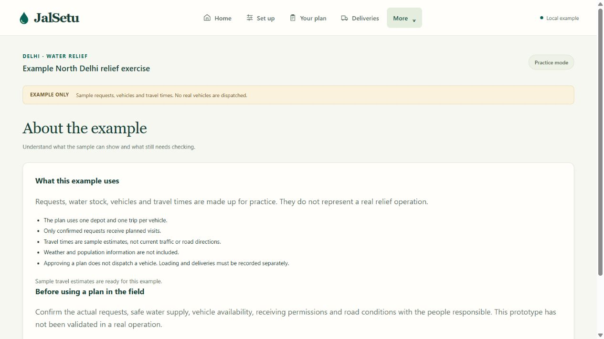

# Customer interface cleanup · 10 October 2026

The user explicitly requested that customers not see JSON or related technical material. This supersedes the earlier design that put technical controls inside expandable sections. The existing application is retained.

## Changes

- Removed the full-input JSON editor and its validation action; the existing resource forms and CSV preview/application remain.
- Removed the evidence JSON, source-ledger JSON and resource-scenario JSON downloads. Internal APIs, saved input snapshots, integrity checks and repository evidence retain their existing formats.
- Removed displayed hashes, job identifiers/stage history, solver runtimes, generic calculation tables and raw source snapshot fields. Plan checks now explain stock/capacity/timing and limits in plain language.
- More → About the example explains the sample data and field limitations. Saved-project buttons omit record versions. Report history shows resource names and quantities rather than raw payload keys. Sign-in omits the backend provider name.
- CSV delivery sheets and printable instructions use readable resource names, approval labels, litres and IST times. They omit internal hashes/job references and algorithm explanations. The customer CSV headings supersede the earlier audit schema; historical audit files are retained as evidence.

The approval, planning and reporting API contracts remain unchanged. Physical accounting and operating-policy safeguards remain in place. No AWS resources or paid provider calls were used.

## Verification

- TypeScript/Ruff checks, production build and updated export-content checks passed. One concurrent build attempt encountered the previously observed Windows memory pressure; a subsequent standalone build passed.
- Export checks verify exact quantities, fixture assignments, resource names, approval state, IST times, HTML escaping and absence of internal hashes. Blob cleanup and strategy-specific approval matching remain checked. Actual browser file saving remains outside this check.
- Browser inspection confirmed the expanded setup has no JSON editor, and generated plan/check views have no hash, JSON or developer diagnostics. The About page has no raw-data downloads. Resource comparison was exercised after the removal.
- Reopened a saved example operation and expanded report history: names and litre quantities were displayed, without payload keys or record versions; the recorded 08:22:45 IST report remained intact.

This is an agent walkthrough, not customer research. The earlier planner tests remain applicable; the domain implementation was not changed by this cleanup.

