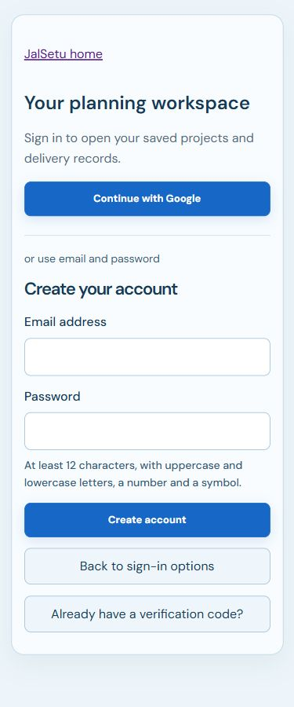

> **Current checkpoint — 11 October 2026:** The updated frontend and email-only Cognito configuration are deployed. Google sign-in is removed from scope. CloudFormation UPDATE_COMPLETE and Amplify release 2 SUCCEED were verified. Real signup-code receipt, password login and reset with the owner’s inbox remain pending. [Current release and checks](aws-email-ui-release-2026-10-11.md) supersede earlier activation/publishing statements below.

# Google and email/password access — 11 October 2026

The owner requested email/password signup and sign-in in addition to Google. This supersedes the Google-only product choice in the earlier frontend request. Both methods are implemented and tested locally. **Neither the new Google integration nor this email extension has been activated or published.** The existing live website still serves its earlier invited-account release. No AWS calls, resources, verification emails or charges were created by these implementation checks.

## User flow

The public blue landing page stays open. Its Sign in action opens the protected workspace gate, which offers Continue with Google, Sign in with email and Create an account. Signup asks for an email address and password. Passwords go directly to Cognito over HTTPS; they never enter JalSetu's API, logs, browser storage or configuration. The field is cleared after submission or leaving signup.

New users verify the code sent to their email, then continue to Cognito's secure sign-in page. Resend code and returning with an existing code are supported. Email users enter their email in Cognito's username field. Forgot password on that page handles the email-code/new-password flow. No phone number or additional social provider is configured. Native sign-in uses the same authorization-code/PKCE S256, state, nonce, signed-token verification, subject-bound refresh and logout flow as Google.

The existing pool uses usernames. JalSetu creates native accounts with the email address as their username instead of changing immutable pool aliases or replacing the pool. Signup trims surrounding whitespace but preserves case; use the same email spelling when signing in. Cognito's own signup page also remains available from its managed sign-in screen and can ask for a username. Previously invited usernames remain usernames. The API requires a verified email, the expected client audience, ID token use and either Google identities or a native identity. Other providers, malformed provider claims and unverified accounts are rejected.

Google and native accounts with the same email remain separate Cognito subjects. Saved projects and operations stay scoped to the subject; no automatic merge or email-based ownership transfer occurs.

## Changes in this extension

| File | Change |
| --- | --- |
| `apps/web/src/EmailAccess.tsx` | Email signup, confirmation, resend, managed sign-in and recovery entry; password clearing and accessible errors. |
| `apps/web/src/auth.ts` | Native signup calls directly to Cognito; account-managed PKCE entry; verified native token handling and refresh. |
| `apps/web/src/Startup.tsx` | Public Sign in opens the account choices; protected gate includes native entry. |
| `apps/web/src/config.ts` | Explicit `GoogleAndEmail` mode; legacy `Google` configurations keep native access disabled. |
| `apps/web/src/identity.css` | Responsive blue access card, readable fields and controls at least 44px high. |
| `.env.example` | Public `VITE_JALSETU_AUTH_PROVIDER=GoogleAndEmail` setting. |
| `infra/app.mjs` | Existing pool self-registration, automatic email verification, email-only recovery and preserved email until updates are verified; app client supports Google and COGNITO. |
| `services/cloud/handler.py` | Verified Google/native authorizer claims and subject ownership; legacy Google-only gate retained. |
| `infra/test-foundation.mjs` | Provider, self-registration, recovery and unchanged username-schema assertions. |
| `scripts/test-google-frontend.mjs` | Native callback/refresh, rejected providers and unverified claims, signup/confirmation/resend, password storage boundary, signup UI and legacy configuration checks. |
| `services/planner/tests/test_cloud_google_identity.py` | Native/Google acceptance and invalid trusted-claim rejection. |
| `scripts/prepare-hosted-web.mjs`, `scripts/test-hosted-web.mjs` | Strict public bundle configuration accepts and tests dual authentication. |
| `scripts/evidence-manifest.mjs`, `docs/evidence-manifest.json` | Callback recognition for dual authentication and refreshed local artifact evidence. |
| `README.md`, `docs/build-status.md`, `docs/decisions.md`, `docs/limitations.md`, `docs/google-auth-frontend-completion-2026-10-11.md` | Updated current scope and activation limits; earlier full UI report retained. |
| `docs/screenshots/email-signup-mobile-2026-10-11.png` | Actual 375px local signup screen. |
| `docs/email-password-auth-2026-10-11.md` | This extension report, current setup and acceptance steps. |

## Checks

- TypeScript and Ruff lint passed; 239 Python tests passed, with three existing SWIG deprecation warnings.
- Production build, CDK synthesis assertions and strict hosting bundle checks passed locally.
- All five local release groups passed, including real restart, preserved saved operations, failure recovery and protected built-file boundaries.
- Google/native authentication and actual React DOM tests passed. These use signed synthetic test tokens and intercepted requests, not real accounts or an application mock-auth fallback.
- Signup layout checked at 320, 375, 768, 1024 and 1440px without horizontal overflow; mobile inputs are 48px high and buttons at least 44px. No account credentials were entered in the browser review.

## Activation still required

1. Complete the Google Console/secret/role steps in [the full frontend report](google-auth-frontend-completion-2026-10-11.md). Credentials must remain private. That report's Google-only provider restriction is superseded by this extension.
2. Review an actual CDK diff of the existing stack before applying it. Preserve the `Coordinators` pool and `WebClient` logical IDs and existing username schema. Enable self-registration, email auto-verification and verified-email-only recovery. Enable Google and COGNITO on the existing public client; authorization-code flow stays enabled, direct password/SRP API authentication stays disabled. Signup/confirmation use public Cognito signup APIs; password sign-in is handled by Cognito managed login. Use the existing Cognito email sender for this demo; additional SES resources were not added. Actual delivery and sender limits must be checked during activation.
3. Deploy the identity gate and publish a new reviewed public bundle with `authProvider: "GoogleAndEmail"`. For local OAuth review, set `VITE_JALSETU_AUTH_MODE=cognito` and `VITE_JALSETU_AUTH_PROVIDER=GoogleAndEmail` alongside the public endpoint values from the full report. Never put passwords or the Google secret in Vite variables or `config.json`.
4. Test a real email signup, received code, wrong/expired code, resend, verified login, password reset, reload, refresh, logout, protected deep links, and isolation between two accounts. Also test Google Gmail/Workspace consent and callback. Real emails, password-reset acceptance and hosted behavior remain unverified until this step. Calling the production API from localhost needs separately reviewed CORS; use the production origin for the full hosted check.

Callback/logout addresses remain unchanged:

| App origin | Callback | Logout |
| --- | --- | --- |
| Localhost | `http://localhost:5173/auth/callback` | `http://localhost:5173/` |
| Loopback | `http://127.0.0.1:5173/auth/callback` | `http://127.0.0.1:5173/` |
| Live site | `https://main.d2d0jtitb5ozce.amplifyapp.com/auth/callback` | `https://main.d2d0jtitb5ozce.amplifyapp.com/` |

The Google Console redirect remains the actual Cognito domain's `/oauth2/idpresponse`, not the app callback. Port 50019 is an unconfigured visual review, not a registered OAuth callback. The original Mumbai scope, $100 credits-only limit and **2026-10-17T17:27:30Z** expiry remain unchanged. No deployment is claimed by this report.

Cognito's [managed login](https://docs.aws.amazon.com/cognito/latest/developerguide/cognito-user-pools-managed-login.html) handles password sign-in and recovery. Its [signup and confirmation workflow](https://docs.aws.amazon.com/cognito/latest/developerguide/signing-up-users-in-your-app.html) and [email verification settings](https://docs.aws.amazon.com/cognito/latest/developerguide/user-pool-email.html) describe the required account configuration.
