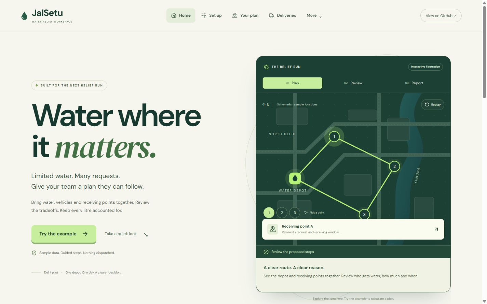
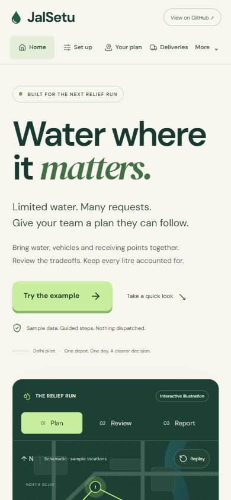
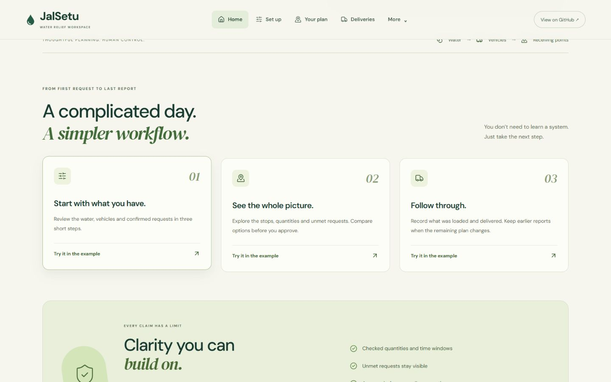

# JalSetu visual and motion completion

Verified 10 October 2026, Asia/Kolkata. This supersedes the previous frontend presentation checkpoint; domain rules and the existing application remain intact.

## Result

The owner asked for a more distinctive frontend, explicitly permitted libraries, authorized making `singh-himanshu3/jalsetu` public, and reserved authentication/authorization for a later task. The supplied reference site was inspected in the browser for its hierarchy and product introduction. Its assets, wording and branding were not copied. No hackathon result is promised.

The introduction now uses an original cream/evergreen/lime identity, a large DM Sans headline with DM Serif Display emphasis, a prominent example action and a schematic relief map. It introduces the problem, previews the workflow, explains the limits, answers first-use questions and offers a final guided-example action. Operational screens share the palette, typography, icons, buttons, input focus treatments and cards. Their compact sidebar remains available while Home has a horizontal product navigation.

The preview has three selectable stages: Plan, Review and Report. Numbered receiving-point buttons change the visible detail card; a Replay control redraws the schematic connection. This artwork contains no live vehicle positions, route-time guarantees, invented water totals or measured impact. It is labelled an interactive illustration with sample locations, and is separate from the calculated Leaflet driver map.

Motion provides finite route drawing, one-time section reveals, screen-entry transitions, and shared navigation/preview selection. Button press/hover and card-hover feedback complete the interactions. The guide's progress is based on actual rules/plan/approval/report state. Native dialogs, inputs, select controls and disclosures retain their existing semantics and behavior. No automatic stage carousel, endless operational background animation or new paid service is added.

## Dependencies and boundaries

- Motion 14.0.0 (`motion/react`, LazyMotion/domAnimation).
- Lucide React 1.54.0, with named icon imports.
- Fontsource DM Sans and DM Serif Display 5.3.0, Latin files bundled into the frontend.
- React, Vite, Leaflet, existing API contracts, polling, planner and operational accounting retained.

Upstream licenses are retained under `docs/licenses/` and documented in `NOTICE.md`. No project license is selected on the owner's behalf. Fonts do not request Google Fonts at runtime. The main built JavaScript entry is approximately 461 kB uncompressed / 139 kB gzip; the Leaflet route module remains separately loaded. No measured field/device performance certification is claimed.

`MotionConfig` follows the system reduced-motion preference. The custom reveal, screen, path, card and progress animations explicitly remove motion under that preference. CSS transitions/reveals and explicit operational scrolling also respect it. The OS preference was not changed for a manual simulation; this part was inspected in code. A general accessibility certification is not claimed.

## Validation

`pnpm check:local` passed: typechecks, Ruff, **237 Python tests**, CSV/storage/operation/export/project/metric/revision/time/guide/history/record/direction/comparison checks, production build and **five real-process release/restart acceptance groups**. The Python run retains three known SWIG deprecation warnings. Final navigation/phone typography/scrolling adjustments were followed by another successful build, release gate and `pnpm test:hosting`. Hosting validation makes no AWS calls and is not a deployment.

Browser checks used actual CSS viewports 1440 × 900, 1024 × 768 and 390 × 844, with no page-level horizontal overflow. An initial decorative-orbit overflow was found and corrected. Phone headline wrapping was corrected so the primary action and preview are easy to find. Home navigation returns to the top even when Home was already selected. The workflow anchor and explanatory disclosure were exercised.

The browser confirmed a route-drawing frame with a partial `stroke-dasharray`, stage selection, receiving-point selection by Space, and a changing description. The native introduction opened, Escape closed it, and focus returned to its trigger. The guide and setup retained explicit closing/loading choices, followed by vehicles and requests. Phone requests used eight cards rather than a wide table. The driver map loaded six actual street tiles; selecting the second stop by Enter changed the map/detail selection, and phone Map/Stop list switching retained it. These are example locations, not a field driver trial.

The synthetic browser exercise generated a checked plan with 12,000 L scheduled and 4,100 L unmet. Comparison showed 900 L more scheduled than demand proportional, with 0.9 km more modelled travel; no strategy is declared universally best. Approval under the label **Synthetic UI motion check** left 12,000 L at the depot. Cancelling a 5,000 L loading review preserved those totals. Confirming loading produced 7,000 L at the depot and 5,000 L onboard. Confirming a 700 L cumulative delivery produced **7,000 L depot + 4,300 L onboard + 700 L reported**, and completed the guide. Final inspected browser logs contained no errors or warnings. The saved exercise is isolated under the workspace's `work/` state folder and is excluded from publication.

## Public repository

The existing repository is now [public on GitHub](https://github.com/singh-himanshu3/jalsetu), as expressly requested. The authorized account and origin were verified. A credential-pattern/path scan checked the 601 historical Git objects and publishable working files; no matches were found for the checked AWS/GitHub credential/private-key patterns or sensitive paths. This is a scoped publication review, not proof that every possible secret pattern or vulnerability has been audited. Saved local operational records, environment credentials, dependency caches and built files are excluded. No GitHub deployment workflow was found in the repository.

The completed frontend and the preceding uncommitted driver/workspace changes are published together, preserving the ongoing project rather than replacing it. The evidence manifest supports `--verify-public-repository` for an explicit read-only GitHub visibility check; normal manifest generation remains offline and does not assume a repository is public.

## Screenshots and handoff

Run **Start JalSetu.cmd** or `pnpm start` for the normal local app. The current isolated review preview runs at `http://127.0.0.1:49996/`. Try the example, choose the two operating rules, review the calculated plan, approve it, and review each report before confirming.

Authentication/authorization are deferred as requested. AWS remains prepared and undeployed under the owner's **Keep prepared; do not deploy** decision. No AWS charges, live hosting, video, hackathon submission or real delivery impact are claimed by this work.

Official implementation references: [Motion React](https://motion.dev/docs/react), [reduced motion](https://motion.dev/docs/react-use-reduced-motion), and [Lucide React](https://lucide.dev/guide/react).
