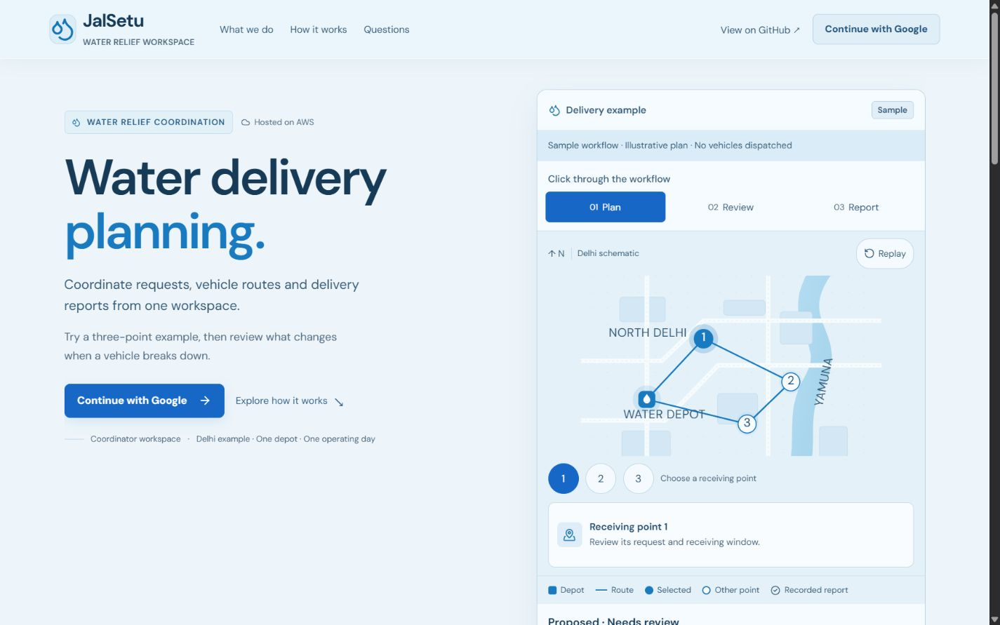

> **Current checkpoint — 11 October 2026:** The updated frontend and email-only Cognito configuration are deployed. Google sign-in is removed from scope. CloudFormation UPDATE_COMPLETE and Amplify release 2 SUCCEED were verified. Real signup-code receipt, password login and reset with the owner’s inbox remain pending. [Current release and checks](aws-email-ui-release-2026-10-11.md) supersede earlier activation/publishing statements below.

# Google-only access and frontend completion — 11 October 2026

**Later scope update:** the owner subsequently requested email/password access alongside Google. See [the implemented email extension and current activation steps](email-password-auth-2026-10-11.md). The Google-only restrictions below record the earlier request and are superseded; this report retains the complete UI inventory and OAuth setup details.

The requested UI, Google-only authentication code and onboarding are implemented in the existing JalSetu application. Local checks pass. **Google authentication has not been activated in AWS, and this update has not been published to Amplify.** Google OAuth credentials and fresh authorized AWS access are still needed. No AWS resources or charges were created during this work.

The existing live address is https://main.d2d0jtitb5ozce.amplifyapp.com/ . It currently serves the earlier invited-account release described in `aws-hosted-release-2026-10-11.md`. The updated public introduction can be reviewed locally at http://127.0.0.1:50019/ . Local sign-in reports that configuration is missing; it does not invent an account or redirect to a mock provider.

## Implemented behavior

- Preserved the pale water-blue identity, glass navigation, existing service cards, looping delivery connector and replayable schematic route. The landing preview shows qualitative Proposed / Needs review / Approved / Reported states; disruption content shows Disrupted / Revised. These are explicitly sample illustrations, not calculated deliveries or claimed impact.
- “Explore delivery changes” scrolls to the disruption card, focuses it and highlights it, without initiating authentication. Receiving-point selection updates the active control, map highlight and matching information card. Preview state changes take 250ms and keep fixed minimum result/detail dimensions.
- The disclaimer is exactly **Sample workflow · Illustrative plan · No vehicles dispatched**. No invented quantities, percentages or impact totals were added to the landing page. Existing sample planning inputs and calculated workspace results remain available.
- Public landing and preview stay accessible. `/workspace` and its Inputs, Plan, Deliveries, Compare, History and Evidence pages require a verified Google session. `/dashboard` is a protected alias. Successful login returns to a known originally requested workspace path; external return URLs are rejected.
- Cognito authorization-code flow uses PKCE S256, state and nonce, and selects Google directly. Callback transactions expire after ten minutes, are consumed once, and authorization codes are removed from the address before token exchange. ID-token signatures are checked against Cognito JWKS, alongside issuer, client audience, expiration, Google identity and verified email. Refresh verifies signatures and binds the new token to the same subject. Logout clears local access immediately and prevents an in-flight refresh from restoring it.
- The workspace displays Google name, email and a permitted Google profile photo, or an initial if no photo is available. There is one sign-in option, **Continue with Google**; no password, magic-link, phone or other-provider flow is offered. Gmail and Workspace addresses have no application-level domain restriction.
- Loading, cancellation, failed callback, expired access, missing configuration and logout have accessible status/alert messages. Logout leaves the user's Google account signed in; it clears JalSetu's browser session, attempts refresh-token revocation, then uses Cognito logout.
- A compact in-page **Welcome to JalSetu.** panel uses the requested sentence and two actions. The existing sample supports inputs → plan → approval → loading/delivery → disruption/revised remaining plan. Reports, approval and replanning still require explicit coordinator actions. Leave/hide/restart are available; Help & account includes **Restart guided example**.
- Welcome completion is remembered per issuer/client/user subject only after a successful sample load and selected entry action. Returning users bypass the welcome panel. Guide progress is temporary; restarting loads the sample but does not delete saved operations. A failed load leaves the welcome available.
- Mobile navigation locks background scroll while open, closes on link selection/Escape, restores previous body overflow and returns focus to its menu button. Reduced motion disables unnecessary motion. Reveal content starts visible and remains visible if observer construction fails, is unavailable, or never responds; a bounded fallback prevents permanently hidden content. Keyboard focus styles remain visible.
- The explicitly labelled offline developer route is `/local-workspace`, enabled only by a deliberate loopback development setting. It uses the existing local API and never authenticates a Google user or grants hosted workspace access. The Windows launcher and development command explicitly select this mode. Built local serving allows only known SPA pages and built assets, preserving source/private-file denial.

## Verification

| Check | Result |
| --- | --- |
| `pnpm lint` (root/web TypeScript and Python Ruff) | Passed; single-threaded TypeScript avoids Windows memory exhaustion observed during a concurrent rerun |
| `pnpm test` | 238 passed; three existing OR-Tools SWIG deprecation warnings |
| `pnpm test:google` | Passed: real generated RSA signatures, Google redirect/PKCE, state/nonce/issuer/audience/provider/signature rejection, cancellation/replay, safe return path, reload/refresh/subject binding, logout race; protected/loading/expiry gates, public interactions, mobile navigation, reduced motion and observer failure; first/returning visits, leave/restart/explore and failed sample loading |
| `pnpm test:example-guide` | Passed; a reported delivery or breakdown alone cannot complete the disruption practice step |
| `pnpm check:hosting` | Passed: production build, CDK synthesis/assertions, public bundle/config validation and stale/private-file exclusion; no AWS calls |
| `pnpm test:release` | Passed: five isolated process/asset/restart/failure-recovery groups, including known SPA deep links and private-file denial |
| Browser widths | 320, 375, 768, 1024 and 1440 checked; no horizontal overflow; map point controls 44 × 44; compact header and responsive service grid |
| Preview layout | At 375px, Plan / Review / Report retained the same approximately 1005px preview height; selected point details updated without moving the section boundary |
| Browser interactions | Mobile Escape restored focus/scroll; disruption action focused/highlighted a visible card; anonymous `/workspace/deliveries` withheld workspace content; missing configuration displayed an alert |
| Real Google consent / live refresh / hosted release | **Pending manual configuration and deployed acceptance**; local tests use explicit test fixtures, never a runtime mock-auth fallback |

## Public environment settings

Safe placeholders are in `.env.example`. For local OAuth review, copy the frontend entries to the ignored `apps/web/.env.local` and fill them from your actual stack. Enable `VITE_JALSETU_AUTH_MODE=cognito` only after all public values are available. Production uses the ten-field `config.json` generated from updated stack outputs rather than a secret-bearing environment file.

| Variable | Meaning |
| --- | --- |
| `VITE_JALSETU_AUTH_MODE` | `cognito` for explicitly configured local Google review; blank uses hosted public configuration |
| `VITE_JALSETU_API_BASE_URL` | Actual Mumbai API Gateway stage URL from stack outputs |
| `VITE_JALSETU_COGNITO_CLIENT_ID` | Public Cognito app-client ID, with no generated client secret |
| `VITE_JALSETU_COGNITO_DOMAIN` | Actual Cognito domain, HTTPS, no endpoint suffix |
| `VITE_JALSETU_COGNITO_ISSUER` | `https://cognito-idp.ap-south-1.amazonaws.com/` followed by the actual user-pool ID |
| `VITE_JALSETU_CALLBACK_URL` | Exact callback matching the local origin below |
| `VITE_JALSETU_LOGOUT_URL` | Exact logout URL matching that same local origin |
| `VITE_JALSETU_EXPIRES_AT` | Existing expiry `2026-10-17T17:27:30Z` |
| `VITE_JALSETU_LOCAL_DEVELOPMENT` | `true` only for explicitly offline loopback development; use `false` for hosted builds |

Infrastructure additionally needs `JALSETU_GOOGLE_CLIENT_ID` (public Google **web** client ID) and `JALSETU_GOOGLE_CLIENT_SECRET_ARN` (the exact Mumbai Secrets Manager secret ARN under `jalsetu/`). The secret's JSON field is `client_secret`; **its actual value never belongs in a VITE variable, frontend source, config.json, Git or chat**. Retain `JALSETU_REGION=ap-south-1`, `JALSETU_EXPIRES_AT=2026-10-17T17:27:30Z` and the existing `CDK_DEFAULT_ACCOUNT` deployment setting. CDK refuses synthesis without the Google provider settings rather than silently enabling native-password authentication.

Runtime tokens are held in memory/sessionStorage for the user's browser session; they are not literals in the source, environment examples or bundles. This storage choice keeps the existing SPA/API architecture. Saved record ownership remains the trusted Cognito subject, never a self-entered email or name.

## Exact app callback and logout URLs

Register these in **Cognito's existing WebClient**:

| Environment | Callback | Logout |
| --- | --- | --- |
| Localhost development | `http://localhost:5173/auth/callback` | `http://localhost:5173/` |
| Loopback development | `http://127.0.0.1:5173/auth/callback` | `http://127.0.0.1:5173/` |
| Production | `https://main.d2d0jtitb5ozce.amplifyapp.com/auth/callback` | `https://main.d2d0jtitb5ozce.amplifyapp.com/` |

The temporary UI-review port **50019 is not an OAuth callback**. Use the normal Vite development port 5173 for local OAuth review. The production API currently permits the Amplify origin only; local OAuth callbacks/session review are supported, but calling the production API directly from localhost requires a separately reviewed API/Lambda CORS change. Use the production origin for complete Google-to-planning acceptance. Offline development continues to use its separate loopback API without cloud requests.

## Google Console and Cognito setup — remaining manual steps

1. Sign in to the owner-controlled Google Cloud project. Configure the OAuth app for **External** audience to support both Gmail and Workspace accounts. Request only openid, email and profile. Testing mode requires approved test users; opening access to other users requires completing Google's production/branding requirements, with the owner's real contact and applicable policy URLs. No contact details or policy declarations have been fabricated.
2. Create an OAuth client of type **Web application**. In Google's client, register the actual Cognito domain as the JavaScript origin and **that domain plus `/oauth2/idpresponse` as the redirect URI**. The Google redirect is to Cognito, whereas the table above describes Cognito's redirects to JalSetu. Copy the actual domain from Cognito or the existing public configuration; do not type the placeholder domain from `.env.example`. [AWS social-provider setup](https://docs.aws.amazon.com/cognito/latest/developerguide/cognito-user-pools-social-idp.html), [Google web OAuth setup](https://developers.google.com/identity/protocols/oauth2/web-server).
3. Store the Google client secret privately in Mumbai Secrets Manager as the `client_secret` JSON field. Review its cost and Google-federation usage against the remaining **$100 credits-only, zero-out-of-pocket** allowance before creating/applying anything. This work has not created that secret or expanded the budget, free plan or seven-day expiry.
4. Fill the infrastructure environment settings above. The constrained CloudFormation execution role needs only the additional Google provider actions for this existing user pool and `secretsmanager:GetSecretValue` for this exact secret. `infra/google-auth-policy.example.json` is a non-applied template: replace ACCOUNT_ID, USER_POOL_ID and secret suffix with real values, review it, and attach it to the existing execution role. It creates no deployment user/access key and grants no administrator policy. Prefer the AWS-managed secret encryption key for this setup; a customer-managed key would additionally require a reviewed decrypt grant.
5. Review the CDK diff using the established restricted deployment workflow. It preserves the current Coordinators pool and WebClient logical identities, adds the Google provider, enables only Google/code flow, disables password/SRP/custom authentication, maps email/name/picture/verified email and permits the three callback/logout pairs. Scopes are openid/email/profile; the public client has no secret and token revocation is enabled. The API authorizer validates the client audience; the Lambda adapter also requires trusted Google/verified-email claims. CSP permits Cognito JWKS/token endpoints and Google profile images while retaining self-only scripts. Apply this reviewed update with fresh authorized AWS access, without extending expiry or adding routing/AI services.
6. Obtain the updated stack outputs. Set the local development flag to false for a hosted build, run the checks, and use `pnpm prepare:hosting <updated-outputs-file> <new-empty-bundle-folder>`. The packager requires **ten public fields**, Google mode and matching callback/logout/issuer. It rejects the old seven-field configuration and secrets/unknown fields. Publish this fresh bundle through the existing manual Amplify release process only after provider/backend configuration succeeds. A Git push does not publish this website.
7. Run live acceptance with a Gmail account and a Workspace account: deep-link return, cancellation/retry, reload/refresh, profile, logout/anonymous denial, first/returning welcome, guide through a disruption/revision, and cross-account saved-record denial. Check the actual Google consent and deployed callback in a browser. Workspace administrators may apply their own restrictions. Preserve old invited-user records: Google identities have different Cognito subjects and must **not** be merged or assigned old records merely because emails match.

The original application concurrency/job/expiry safeguards remain. Expiry closes planning but does not delete billed AWS resources: the existing reviewed cleanup is still required. The earlier live release evidence is separate from this prepared Google update. No real-world delivery benefit, NGO trial, video or submission is claimed.

## Changed files

The following inventory includes the earlier uncommitted UI refinements retained in this delivery and all changes made for this request. Private `work/` helpers and ignored build/dependency folders are not repository deliverables.

| File | Change |
| --- | --- |
| `.env.example` | Public settings and secret-ARN placeholders; no credentials. |
| `NOTICE.md` | Development dependency license notice. |
| `README.md` | Project entry documentation. |
| `Start JalSetu.cmd` | Explicit offline developer-workspace launcher. |
| `apps/web/package.json` | Google test command, dev-only jsdom dependency or bounded TypeScript checks. |
| `apps/web/src/App.tsx` | Targeted public UI, Google access, workspace routing or guided onboarding. |
| `apps/web/src/ExampleGuide.tsx` | Targeted public UI, Google access, workspace routing or guided onboarding. |
| `apps/web/src/LandingServices.tsx` | Targeted public UI, Google access, workspace routing or guided onboarding. |
| `apps/web/src/Motion.tsx` | Targeted public UI, Google access, workspace routing or guided onboarding. |
| `apps/web/src/Operations.tsx` | Targeted public UI, Google access, workspace routing or guided onboarding. |
| `apps/web/src/Overview.tsx` | Targeted public UI, Google access, workspace routing or guided onboarding. |
| `apps/web/src/PlanningPreview.tsx` | Targeted public UI, Google access, workspace routing or guided onboarding. |
| `apps/web/src/Startup.tsx` | Targeted public UI, Google access, workspace routing or guided onboarding. |
| `apps/web/src/api.ts` | Targeted public UI, Google access, workspace routing or guided onboarding. |
| `apps/web/src/auth.ts` | Targeted public UI, Google access, workspace routing or guided onboarding. |
| `apps/web/src/config.ts` | Targeted public UI, Google access, workspace routing or guided onboarding. |
| `apps/web/src/env.d.ts` | Targeted public UI, Google access, workspace routing or guided onboarding. |
| `apps/web/src/example-progress.ts` | Targeted public UI, Google access, workspace routing or guided onboarding. |
| `apps/web/src/identity.css` | Targeted public UI, Google access, workspace routing or guided onboarding. |
| `apps/web/src/onboarding.ts` | Targeted public UI, Google access, workspace routing or guided onboarding. |
| `apps/web/src/workspace-route.ts` | Targeted public UI, Google access, workspace routing or guided onboarding. |
| `docs/audit/local-release-check-2026-10-10.json` | Completion/setup report, decisions, status, limits or local verification evidence. |
| `docs/build-status.md` | Completion/setup report, decisions, status, limits or local verification evidence. |
| `docs/decisions.md` | Completion/setup report, decisions, status, limits or local verification evidence. |
| `docs/evidence-manifest.json` | Refreshed local evidence hashes; no Google deployment claimed. |
| `docs/frontend-identity-review-2026-10-11.md` | Completion/setup report, decisions, status, limits or local verification evidence. |
| `docs/google-auth-frontend-completion-2026-10-11.md` | Completion/setup report, decisions, status, limits or local verification evidence. |
| `docs/licenses/jsdom-MIT.txt` | Development dependency license notice. |
| `docs/limitations.md` | Completion/setup report, decisions, status, limits or local verification evidence. |
| `docs/screenshots/google-ui-desktop-2026-10-11.png` | Saved local browser review. |
| `infra/app.mjs` | Prepared Google/Cognito configuration, scoped policy example or synthesis assertions; not applied to AWS. |
| `infra/google-auth-policy.example.json` | Prepared Google/Cognito configuration, scoped policy example or synthesis assertions; not applied to AWS. |
| `infra/test-foundation.mjs` | Prepared Google/Cognito configuration, scoped policy example or synthesis assertions; not applied to AWS. |
| `package.json` | Google test command, dev-only jsdom dependency or bounded TypeScript checks. |
| `pnpm-lock.yaml` | Google test command, dev-only jsdom dependency or bounded TypeScript checks. |
| `scripts/dev.mjs` | Local launcher/deep-link serving, public hosting preparation or evidence tooling. |
| `scripts/evidence-manifest.mjs` | Local launcher/deep-link serving, public hosting preparation or evidence tooling. |
| `scripts/local-web.mjs` | Local launcher/deep-link serving, public hosting preparation or evidence tooling. |
| `scripts/prepare-hosted-web.mjs` | Local launcher/deep-link serving, public hosting preparation or evidence tooling. |
| `scripts/test-example-guide.mjs` | Automated regression/acceptance checks. |
| `scripts/test-google-frontend.mjs` | Automated regression/acceptance checks. |
| `scripts/test-hosted-web.mjs` | Automated regression/acceptance checks. |
| `scripts/test-local-release.mjs` | Automated regression/acceptance checks. |
| `services/cloud/handler.py` | Trusted Google provider/client/verified-email enforcement; ownership remains subject-based. |
| `services/planner/tests/test_cloud_google_identity.py` | Automated regression/acceptance checks. |
