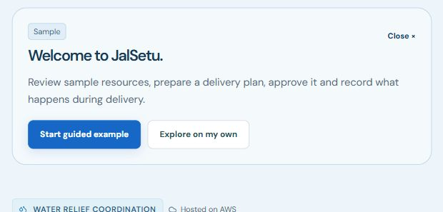

# Sign-in callback correction — 11 October 2026

## Defect and evidence

The owner reported successful Cognito sign-in followed by the public landing page instead of the workspace. A direct HTTPS check of the deployed host returned **301** from `/auth/callback?code=route-check&state=route-check` to `/auth/callback/?code=route-check&state=route-check`. These are synthetic probe values, not account codes. Workspace deep links receive the same trailing-slash redirect.

The frontend required the exact `/auth/callback` pathname. With the host's slash, it skipped the callback exchange and rendered the public introduction. Earlier isolated authentication tests did not model this host behavior. The reported defect is reproducible without collecting a user's password.

## Correction

- Normalize trailing slashes when identifying internal routes and the callback. The OAuth token exchange still sends the **exact registered redirect URI**; PKCE, state, nonce, signature, verified-email, audience and expiry checks remain required.
- Preserve the intended workspace tab for slash-suffixed deep links.
- Remove callback query parameters before exchange as before. Callback failures now remain on the workspace sign-in gate with an error and retry controls, instead of sending the user back to the landing page.
- Preserve the pool/client, account ownership, native-only provider configuration, application limits and original expiry. This is a frontend update; no infrastructure change is required.

## Checks and release

TypeScript/Ruff lint, frontend authentication/DOM checks, production build, CDK assertions and public bundle checks passed. New tests cover the slash-suffixed callback, unrelated-path refusal, query cleanup, exact registered redirect URI, normalized workspace deep links and the **actual Startup component under React StrictMode**, completing the native callback into the authenticated workspace and onboarding. Test requests and tokens are synthetic; no app account/password was collected.

Corrected bundle: `index-Cu3BOzta.js`, verified in the live index. Amplify release **3** reached **SUCCEED**. The owner entered their app credentials privately in the secure browser page. The real callback opened `/workspace`, removed its query parameters and showed authenticated account controls and first-use onboarding, with no error or public landing page. A full reload followed the host’s `/workspace/` redirect and restored the same authenticated workspace. No account email, password, code or token is retained in this report or screenshot.

