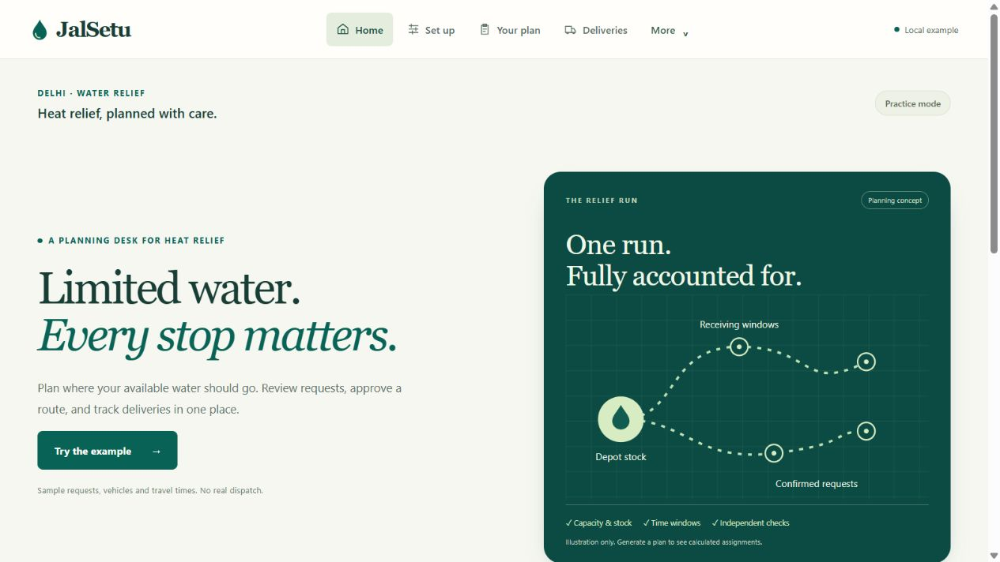
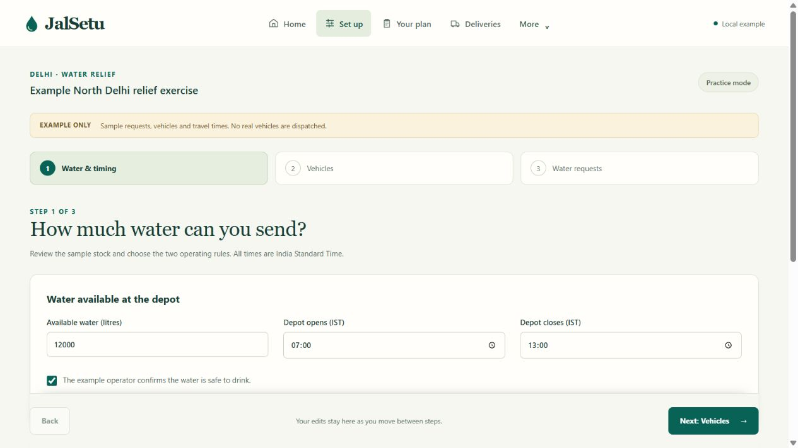
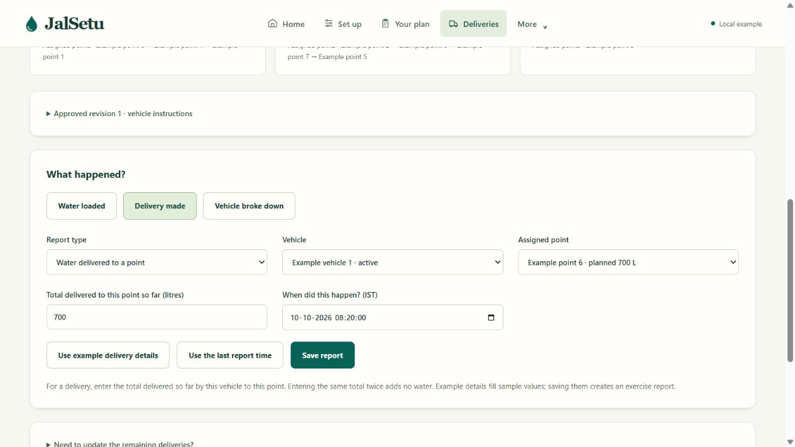
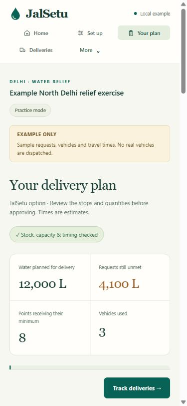

# Example-first usability update · 10 October 2026

The user asked for a customer to use JalSetu without learning its technical structure, and selected **Try the example first** for new visitors. This update extends the existing frontend and visual refresh; the planner, validator, APIs, saved projects and operations ledger remain the existing implementation.

## What changed

- Home has one primary first-time action: **Try the example**. It loads an unsaved, clearly labelled sample. The read-only quick-example path no longer requires a separate acknowledgement checkbox. Saved project creation still requires its explicit synthetic-data acknowledgement, and approving a plan or saving a report remains a deliberate action.
- Main navigation uses **Home → Set up → Your plan → Deliveries**. Comparison and sources remain accessible under **More**. A visitor returning to their current draft sees Continue setup or Open your plan, instead of a primary action that resets their work.
- Setup presents three steps: water/timing, vehicles, and water requests. Existing example values are filled in. Back/Next retains edits; native time pickers use IST. Loading and closing rules remain unset until explicitly chosen. Required-choice messages scroll into view. Resource editing, CSV import and JSON are available in More setup options; working and receiving hours have their own expandable sections.
- Plans lead with water quantities, unmet requests and vehicle instructions. Names replace IDs in the main instruction/reporting views; partial requests say Partially covered. The selected strategy remains visible. A persistent next action leads to the approval form; an already-approved matching plan leads to delivery tracking. Detailed calculations, check explanations and job stages are expandable.
- Reporting has three common action buttons, readable vehicle/point choices, and an IST date-and-time picker for reports and updated plans. Example helpers remain explicitly labelled and never save a report automatically. Exact integer litres, cumulative delivery semantics, conservation and depot-only revision restrictions are preserved. Report history retains accounting and identity disclosures.

## Verification

- `pnpm test`: 156 Python tests passed; three existing OR-Tools SWIG deprecation warnings remain.
- `pnpm lint`, `pnpm build`, `pnpm test:exports` and `pnpm test:report-time` passed. Time conversion checks cover UTC, New York and Kolkata, midnight rollover and seconds.
- Browser walkthrough: one-click example loading; missing-rule message; retained stock edits across Back/Next; three-step generation; plan review/approval; loading 5,000 L; reporting 700 L delivered; repeated cumulative reports added no water. Ledger remained 7,000 L at depot + 4,300 L onboard + 700 L reported delivered.
- Browser checks caught native picker edits reverting on rerender. Listening to the native input event fixed this. A saved report retained **08:22:45 IST**, and an edited depot opening time survived forward/back navigation.
- Desktop and 360px/390px phone layouts were inspected. Setup, plan, comparison and delivery views had no page-level horizontal overflow in the checked widths. The More menu stayed inside the phone width and closed after choosing comparison. Persistent setup/plan actions remained visible.

This is an agent browser walkthrough, not a customer study or field validation. Live AWS, provider integration, public publication and actual browser export-file saving remain outside the verified gate. No cloud deployment or paid calls were performed.

## Screenshots

